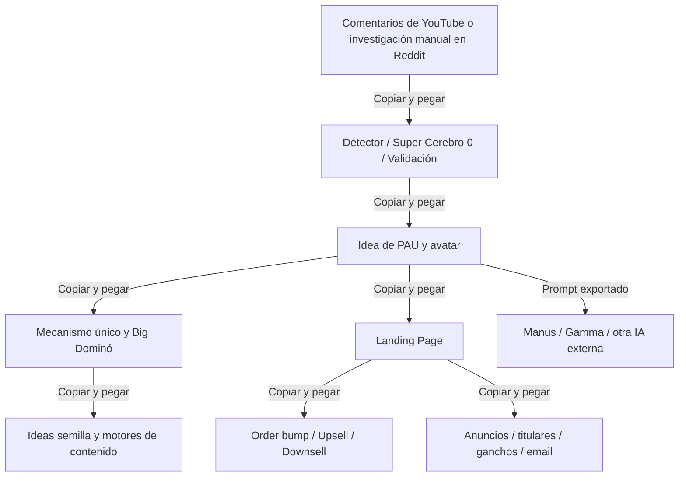

# Investigación técnica preliminar de COPA / Pilas Academy

**Fecha de inspección:** 12 de agosto de 2026  
**Objeto principal de fase 1:** [app.pilasacademy.com](https://app.pilasacademy.com/)  
**Estado:** investigación pública y anónima; no se inició sesión, no se compró nada y no se intentó eludir controles de acceso.

> **Actualización de segunda fase (12 de agosto de 2026):** el usuario aportó la superficie nueva [app.copa.pilasacademy.com](https://app.copa.pilasacademy.com/). No es un mero alias: sirve otra aplicación (React 19.1.1 + Wouter v3), usa tRPC, IDs numéricos, cookies de sesión, Cloudflare y `cname.manus.space`. Los hallazgos React 18 + REST + Google Frontend de este informe siguen siendo válidos para el dominio heredado. La arquitectura comparada está en `COPA_TECHNICAL_ARCHITECTURE.md`.

## Resumen ejecutivo

COPA es una aplicación web propia que reúne asistentes especializados llamados “Cerebros IA” y algunas herramientas programáticas. La evidencia pública permite afirmar que:

- El frontend es una SPA en **React 18.3.1**; usa `createRoot`, un elemento `#root`, rutas con **Wouter** y un único bundle versionado. La huella es compatible con Vite, pero Vite queda como inferencia, no como hecho confirmado.
- El backend expone una API propia bajo `/api/*`, responde con `X-Powered-By: Express` y se sirve mediante `Google Frontend`/`Via: google`.
- La política de privacidad de COPA declara expresamente **OpenAI para la funcionalidad de IA**, Stripe para pagos y Resend para email. No se encontró el nombre del modelo concreto.
- El catálogo público actual devuelve **28 Cerebros de marketing** y **5 Cerebros de contenido**: 33 Cerebros en total. El dashboard anónimo solo muestra los 28 de marketing; dos están marcados como gratuitos y 26 como bloqueados.
- La afirmación promocional de **47 herramientas** no se pudo reproducir como inventario actual. Los endpoints públicos actuales no devuelven 47 elementos y los números de orden tienen huecos, señal de altas, bajas y reorganizaciones históricas.
- La conexión entre Cerebros es, en la implementación observable, principalmente **manual**: un Cerebro pide pegar el resultado del anterior. No apareció una entidad “proyecto”, un grafo de workflow ni una llamada que transfiera automáticamente la salida de un Cerebro a otro.
- El Extractor de YouTube es procesamiento propio del backend: recibe una URL y, en una prueba pública, devolvió exactamente 500 objetos `{author, text}`. La interfaz invita a copiarlos y pegarlos en otros Cerebros; no hay transferencia automática observable.
- La oferta pública está desincronizada. La app todavía anuncia `$19.99/mes`, “9 GPTs” y prueba gratuita; la comunidad pública más reciente presenta COPA dentro del VIP, publicó una oferta de `$50/mes` y anunció el 10 de julio de 2026 la eliminación del beneficio Free por nivel 4.

## Addendum ejecutivo — segunda fase

- **33 vs 47:** 33 registros son enumerables y verificables en la API heredada. La aplicación nueva no contiene 47 definiciones en su bundle ni las devuelve anónimamente; su portada ahora dice `+30`. Los 17 huecos del campo `order` y los nombres históricos explican un catálogo acumulado/reorganizado, pero no prueban 47 simultáneos.
- **Modelo:** `MODELO OPENAI: NO VERIFICADO`. No aparecieron GPT-4o, GPT-4.1, GPT-5, mini, Responses API, Chat Completions, Assistants API, temperatura o tokens en bundles/cabeceras/respuestas normales.
- **Router de Cerebros:** la app nueva usa `chat.send({gptId,message})` bajo `/api/trpc`; la heredada usa `POST /api/chat/:gptId` con `{message}`. No se observó backend separado por Cerebro.
- **Prompts:** la app nueva administra `name`, `description`, `prompt` e `isFree` mediante CRUD tRPC de admin. El chat sólo envía ID+mensaje, por lo que la configuración vive server-side, probablemente en base de datos.
- **Extractor:** el procedimiento nuevo `youtube.extractComments` devuelve `{comments:[{author,text,likes}],videoId}`. Dos extracciones heredadas consecutivas fueron byte por byte idénticas; la nueva mantuvo los mismos 500 autores y orden. YouTube Data API v3 es probable por `textDisplay` HTML y `likeCount`, pero no queda verificada.
- **Clasificación:** los 33 Cerebros verificables son A — Prompt + LLM. El procesamiento especializado está en herramientas auxiliares (Extractor C, Calculadora C, HTML B y Post Generator B).
- **Seguridad pasiva:** los catálogos heredados exponen anónimamente el campo `prompt` de Cerebros premium. `POSIBLE VULNERABILIDAD — NO EXPLOTADA`. La nueva app evita esa exposición anónima. También usa `dangerouslySetInnerHTML` para comentarios; la sanitización backend no es verificable y no se intentó XSS.

Archivos de segunda fase:

- `COPA_TECHNICAL_ARCHITECTURE.md`
- `COPA_BRAINS_INVENTORY.md`
- `COPA_OPEN_QUESTIONS.md`

## Metodología y límites

Se usaron únicamente:

- navegación anónima por páginas públicas;
- recursos que la propia aplicación carga;
- el bundle JavaScript público;
- solicitudes GET/POST que la interfaz pública realiza por sí misma;
- una URL pública de YouTube para probar el extractor;
- un mensaje de prueba no sensible enviado a uno de los dos Cerebros gratuitos;
- publicaciones públicas de la comunidad.

No se inspeccionaron cuentas, datos de terceros, credenciales, paneles privados ni contenido tras el paywall. Tampoco se intentó adivinar rutas, alterar parámetros de autorización, forzar roles o probar credenciales. No se inspeccionó el almacén de cookies o perfiles del navegador; sí se documentaron los encabezados HTTP públicos y las referencias de almacenamiento visibles en el bundle.

---

# VERIFICADO

## 1. Identidad y propuesta pública

La aplicación usa el título **“COPA - El Constructor de Ofertas de Pilas Academy”**. La portada la presenta como una suite que cubre investigación, oferta, páginas, anuncios y email. El dashboard dice “Selecciona un GPT gratuito”, aunque la terminología interna alterna entre GPT, Cerebro y asistente. Fuentes directas: [portada](https://app.pilasacademy.com/), [dashboard](https://app.pilasacademy.com/dashboard).

Una publicación pública más reciente define COPA como un conjunto de Cerebros especializados y aclara: “COPA no construye. COPA piensa”; menciona herramientas externas como Manus o Claude para ejecutar algunos resultados. [Qué es COPA y cómo te ayuda](https://www.skool.com/la-maquina-de-resultados/que-es-copa-y-como-te-ayuda?p=fb9c253f).

## 2. Frontend

### Tecnología observada

| Elemento | Evidencia | Estado |
|---|---|---|
| React 18.3.1 | `react-dom` 18.3.1 y `createRoot(...).render(...)` en el bundle | Verificado |
| Wouter | Router y rutas compiladas con Wouter | Verificado |
| SPA cliente | `#root`, un bundle JS, navegación cliente y fallback de rutas | Verificado |
| Next.js | No hay `#__next`, `__NEXT_DATA__` ni `webpackChunk_N_E` | Descartado para la versión inspeccionada |
| Vite | Bundle `/assets/index-[hash].js` y CSS equivalente | Probable |
| Tailwind/Radix/Lucide | Clases utilitarias, componentes `data-radix-*` e iconos Lucide en DOM | Verificado como huella de UI |

### Rutas públicas presentes en el bundle

```text
/
/activate
/admin
/auth
/ayuda
/calculadora-ads
/content-engine
/dashboard
/extractor
/forgot-password
/ganchos
/html-generator
/landing-html
/privacy
/purchase-success
/reset-password
/terms
/welcome
```

Acceso anónimo observado:

- `/`, `/dashboard`, `/extractor`, `/ganchos`, `/html-generator`, `/privacy`, `/terms` y `/ayuda` cargan una superficie pública.
- `/content-engine`, `/calculadora-ads` y `/landing-html` redirigen a `/auth` sin una sesión.
- `/html-generator` muestra la interfaz de entrada, pero el bundle valida plan VIP antes de generar.

### Almacenamiento en el cliente

El bundle referencia estas claves de `localStorage`:

```text
token
theme
dashboard-selected-gpt
dashboard_seen_sidebar
content-engine-selected-gpt
html-generator-page-type
html-generator-mockup-url
html-generator-copy-text
copa-notes-${gptId}
```

El token de autenticación se añade como `Authorization: Bearer <token>` a las solicitudes. Las notas se guardan por Cerebro en `copa-notes-${gptId}`. Una nota anónima de prueba sobrevivió una recarga y luego fue eliminada.

El servidor también envía una cookie de sesión llamada `GAESA`; la política pública afirma que se usan cookies de sesión esenciales. No se inspeccionó su valor ni el almacén del navegador. [Política de privacidad](https://app.pilasacademy.com/privacy).

## 3. Backend e infraestructura visible

Los encabezados públicos del 12 de agosto de 2026 mostraron:

```text
Server: Google Frontend
Via: 1.1 google
X-Powered-By: Express
Strict-Transport-Security: max-age=63072000; includeSubDomains
```

El DNS de `app.pilasacademy.com` resolvió a `34.111.179.208` durante la inspección.

Esto verifica **Express** como framework HTTP declarado y una capa de entrega de Google. No identifica por sí solo si el servicio corre en App Engine, Cloud Run u otro producto de Google Cloud.

### API observable

| Método y endpoint | Request/uso visible | Response observada o esperada por el cliente |
|---|---|---|
| `GET /api/auth/me` | Comprobar sesión | `401 {"error":"No autorizado"}` sin sesión |
| `POST /api/auth/login` | `{email,password}` | Devuelve token que el cliente guarda |
| `POST /api/auth/register` | `{email,password}` | Devuelve token |
| `POST /api/auth/register-free` | Registro Free; hallado en bundle | No ejecutado |
| `POST /api/auth/forgot-password` | Recuperación | No ejecutado |
| `POST /api/auth/reset-password` | Restablecimiento | No ejecutado |
| `GET /api/gpts` | Catálogo marketing | Array público de 28 objetos |
| `GET /api/content-gpts` | Catálogo de contenido | Array público de 5 objetos |
| `POST /api/chat/:gptId` | `{message}` | `{response}`; el cliente admite además IDs de conversación/mensajes si vienen |
| `GET /api/conversations/:gptId` | Historial por Cerebro | `{conversationId,messages}`; una sesión HTTP nueva y anónima devolvió `null, []` |
| `DELETE /api/conversations/:conversationId` | Borrar conversación | Visible en bundle; no ejecutado |
| `POST /api/conversations/:conversationId/edit-message` | `{messageId}` | Visible en bundle; no ejecutado |
| `POST /api/extract-comments` | `{url}` | `{comments,total}` |
| `POST /api/stripe/create-checkout` | Crear checkout VIP | Visible; no ejecutado |
| `POST /api/stripe/create-portal` | Portal de suscripción | Visible; no ejecutado |
| `GET /api/subscription/status` | Estado de suscripción | Visible; no ejecutado |
| `POST /api/generate-html-pilas` | `{copyText,mockupUrl?,pageType}` | HTML, ID de generación y generaciones restantes |
| `GET /api/html-generations/:id` | Recuperar generación | Visible; no ejecutado |
| `POST /api/tools/calculadora-ads` | Calculadora de anuncios | Visible; ruta protegida, no ejecutado |
| `GET /api/tutorials` | Tutoriales | Devolvió `[]` durante la inspección |

También existen endpoints administrativos en el bundle, pero no se llamaron y no forman parte de la superficie anónima legítima.

## 4. Inteligencia artificial

La [política de privacidad](https://app.pilasacademy.com/privacy) declara dos veces que COPA integra **OpenAI para funcionalidad de IA**. Esto es evidencia directa del proveedor, aunque la política tiene fecha de actualización “octubre de 2025”.

En el bundle no aparecen nombres de modelos (`gpt-4*`, `gpt-3*`, `o1`, `o3`, etc.), ni referencias a Anthropic, Gemini, OpenRouter o Groq. El frontend nunca llama directamente a OpenAI: envía el mensaje al backend propio mediante `/api/chat/:gptId`.

Prueba anónima:

```json
POST /api/chat/1b4dbcea-b6c6-4849-8bad-fcf950ea0af9
{"message":"Responde únicamente con la palabra PRUEBA."}

200
{"response":"...presentación predeterminada del Cerebro PAU..."}
```

La respuesta siguió el prompt del Cerebro y no la instrucción literal de “solo PRUEBA”, demostrando que existe una instrucción de sistema o equivalente con prioridad.

## 5. Catálogo actual de Cerebros públicamente enumerables

Los objetos públicos tienen esta forma:

```text
id, name, prompt, createdBy, order, isFree, category, instructions, createdAt
```

No hay en esos objetos un campo de modelo, temperatura, archivos, vector store, herramientas, esquema RAG ni dependencias entre Cerebros.

### 5.1 Marketing — 28 Cerebros

| Orden | Cerebro | Acceso anónimo | Entrada principal | Salida principal / conexión | Naturaleza observable |
|---:|---|---|---|---|---|
| 0 | VALIDA SI TU IDEA ES UN PAU | Sí | Idea de producto | Checklist de 4 criterios, veredicto y recomendaciones | Prompt + LLM |
| 1 | INVESTIGACIÓN REDDIT | Sí | Nicho | Subreddits y estrategias de búsqueda; guía por fases | Prompt + LLM; búsqueda viva no observada |
| 2 | Super Cerebro 0 Analizador de Comentarios | No | Comentarios de redes | Un PAU principal, 6 upsells y bloque listo para Manus | Prompt + LLM |
| 3 | GENERADOR DE IDEAS DE PAU | No | Comentarios/dolores | Ideas de PAU accionables y estructura para Gamma | Prompt + LLM |
| 4 | VALIDACIÓN Y CREACIÓN | No | Comentarios de YouTube/Reddit/TikTok | Avatar profundo, dolores, demanda inferida e ideas validadas | Prompt + LLM |
| 5 | GENERADOR DE MECANISMO UNICO | No | Información del PAU | 10 mecanismos únicos | Prompt + LLM |
| 6 | TITULARES CON MECANISMO | No | Mecanismo del Cerebro anterior | 3 titulares + subtítulos | Prompt + LLM; dependencia manual explícita |
| 8 | PAU Marketing Expert | No | Descripción del PAU | Estrategia de marketing/oferta | Prompt + LLM |
| 9 | Detector de Problemas Urgentes | No | Hasta 200 comentarios pegados | Dolores, frustraciones, deseos y prioridad | Prompt + LLM |
| 10 | AVATAR Y PRODUCTO | No | Investigación previa | Psicografía, avatar y consolidado final | Prompt + LLM |
| 11 | Landing Page | No | Salida de Avatar y Producto | Copy de landing en 16 secciones | Prompt + LLM; pega manual |
| 12 | Generador de Order Bumps Upsell | No | Avatar/Producto + copy de landing | Ideas de order bumps y upsells | Prompt + LLM |
| 15 | Redactor de Página de Upsell | No | Idea de upsell + landing/URL | Copy completo de upsell | Prompt + LLM |
| 16 | Pagina Dowsell Copy | No | Página de upsell o URL | Copy de downsell | Prompt + LLM |
| 22 | ANUNCIOS que SI VENDE / LA BESTIA DEL COPY | No | Página de ventas o URL | Anuncios en 9 estilos, entregados por bloques | Prompt + LLM |
| 26 | TITULARES DE ALTO IMPACTO | No | Avatar/Producto + landing | Titulares de respuesta directa | Prompt + LLM |
| 30 | CREADOR DE GANCHOS | No | Avatar/Producto + landing | Ganchos para tráfico frío | Prompt + LLM |
| 33 | Aumenta el Valor de tu Oferta | No | Avatar/Producto + landing | Ajustes de branding simbólico y valor percibido | Prompt + LLM |
| 35 | Secuencia de Email | No | Datos del PAU/oferta | Secuencia de recuperación de carrito | Prompt + LLM |
| 36 | GENERADOR PAU HTML | No | Idea de PAU | Prompt detallado para que Manus cree una mini-app HTML | Prompt + LLM; no genera código por sí mismo |
| 37 | BIG DOMINO CREENCIAS | No | Comentarios | Creencias limitantes exactas | Prompt + LLM |
| 38 | BIG DOMINÓ BUILDER | No | Creencias + titular + mecanismo | Verdad central y Big Dominó Statement | Prompt + LLM |
| 39 | IDEAS SEMILLAS | No | Creencias + Big Dominó + mecanismo | 60 ideas semilla en tres categorías | Prompt + LLM |
| 40 | BD CONTENIDO UNIVERSAL | No | Contexto del negocio + idea semilla | Post adaptado al nicho | Prompt + LLM; contexto conservado en conversación |
| 41 | BD AUTORIDAD UNIVERSAL | No | Negocio/audiencia + tema | 2 posts de autoridad | Prompt + LLM |
| 42 | BD INSPIRACIONAL | No | Negocio/audiencia + semilla | 2 posts inspiracionales | Prompt + LLM |
| 43 | GENERADOR DE PAU DIGITALES | No | 200–300 comentarios | Prompt para Manus: landing + 4 herramientas + thank-you | Prompt + LLM |
| 44 | Generador de PAUs Accionables desde Comentarios | No | Comentarios | Análisis, Big Dominó, 5–7 PAUs y plan de 20 páginas para Gamma | Prompt + LLM |

### 5.2 Contenido — 5 Cerebros

La ruta `/content-engine` exige login, pero su endpoint de catálogo devuelve públicamente cinco metadatos/prompt:

| Orden | Cerebro | Entrada | Salida | Conexión |
|---:|---|---|---|---|
| 45 | MOTOR DE VERDADES CORTAS | Creencias + Big Dominó + mecanismo | 60 verdades cortas | Pega manual desde Cerebros 37/38 |
| 46 | MOTOR DE VERDADES INCÓMODAS | Mismos tres insumos | 60 verdades confrontativas | Pega manual |
| 47 | MOTOR DE CONTRASTES (A PIERDE / B GANA) | Mismos tres insumos | 60 contrastes de dos líneas | Pega manual |
| 48 | MOTOR DE PRINCIPIOS ESTRUCTURALES | Mismos tres insumos | 60 frases en seis estructuras | Pega manual |
| 49 | GENERADOR UNIVERSAL DE GANCHOS (BIG DOMINÓ) | Creencias + Big Dominó + titular/mecanismo | 10 hooks por ángulos; variaciones opcionales | Pega manual |

### 5.3 Herramientas no equivalentes a un Cerebro de chat

| Herramienta | Estado | Procesamiento |
|---|---|---|
| Extractor de Comentarios de YouTube | Público, sin registro | Backend propio `/api/extract-comments` |
| Ganchos Polarizadores | Página pública educativa | Contenido estático, no chat |
| Generador de Páginas HTML | Interfaz pública; generación VIP | Backend `/api/generate-html-pilas` |
| Calculadora de Ads | Login obligatorio | Backend `/api/tools/calculadora-ads` |
| Landing HTML | Login obligatorio | Función diferenciada del Cerebro “Landing Page” |

## 6. Cómo se conectan los Cerebros

La hipótesis de flujo general es correcta, pero la conexión técnica observable no es una automatización de datos. Los prompts dicen repetidamente “pega aquí la salida del Cerebro anterior”.



Evidencias concretas:

- El request de chat contiene únicamente `{message}` y el ID del Cerebro está en la URL.
- No hay campos de “projectId”, memoria compartida, variables de workflow ni referencias a outputs anteriores.
- No se hallaron endpoints de proyectos en el bundle.
- Los resultados del extractor se formatean en el frontend como `Comentario N / Autor / texto` y se copian al portapapeles.
- Las notas son locales por Cerebro; no constituyen un contexto global compartido.
- La ayuda afirma que las conversaciones de cuentas se guardan automáticamente. Una conversación anónima de prueba desapareció al recargar.

## 7. Extractor de YouTube

### Contrato observado

```json
POST /api/extract-comments
{"url":"https://www.youtube.com/watch?v=dQw4w9WgXcQ"}
```

```json
{
  "comments": [
    {"author":"@YouTube","text":"..."}
  ],
  "total": 500
}
```

### Hechos verificados

- La entrada es un único campo URL; el placeholder acepta una URL `youtube.com/watch?v=...`.
- No hay parámetro cliente para cantidad, orden, páginas o respuestas.
- Una prueba con un video de gran volumen devolvió **500 comentarios**.
- Cada comentario contiene únicamente `author` y `text`.
- No se devolvieron IDs, fechas, likes, reply count, URL del comentario, idioma ni metadatos del video.
- En esa muestra no hubo duplicados exactos de `author + text`; hubo 4 textos repetidos entre autores diferentes. Esto no demuestra una rutina de deduplicación.
- La UI no renderiza la lista; muestra el total y ofrece “Copiar Todos”.
- El propio texto de la interfaz dice que los comentarios están “formateados para pegar directamente” en los Cerebros.
- El Detector de Problemas indica un máximo recomendado de 200 comentarios; otros Cerebros piden 200–300. El extractor entrega 500, por lo que el usuario debe seleccionar o pegar manualmente.

Fuente pública directa: [Extractor de YouTube](https://app.pilasacademy.com/extractor).

## 8. Definición interna observable de PAU

El Cerebro gratuito de validación define cuatro criterios obligatorios:

1. **Percepción como herramienta:** se usa, no se estudia.
2. **Resultados inmediatos:** 1–3 días, máximo 72 horas.
3. **Alto valor percibido:** ahorro claro de tiempo, dinero o esfuerzo; puede sustituir un servicio costoso.
4. **Consumo rápido:** idealmente un día, instrucciones simples y un máximo de cinco pasos.

Su formato de evaluación usa sí/no por criterio, seguido de uno de tres veredictos:

```text
ES PAU
NO ES PAU
PUEDE SER PAU CON AJUSTES
```

No usa una puntuación numérica.

Otros Cerebros añaden requisitos no idénticos: “20 páginas exactas”, consumo en 15–30 minutos, elementos rellenables, checklists, plantillas, roadmaps o scripts. Hay por tanto una metodología común, pero no una única definición perfectamente normalizada entre todos los prompts.

El Cerebro gratuito no consulta competencia o demanda externa. Razona sobre la idea que el usuario le proporciona. “VALIDACIÓN Y CREACIÓN” y otros prompts prometen analizar demanda/competencia a partir de comentarios, pero no se observó una API externa ni herramientas de búsqueda en sus requests.

## 9. Plan Free, VIP y precios

### Lo que muestra hoy la app pública

- Dos Cerebros con `isFree: true`: “VALIDA SI TU IDEA ES UN PAU” e “INVESTIGACIÓN REDDIT”.
- Extractor de YouTube sin registro.
- Portada con “Comience su Prueba Gratuita”.
- Oferta visible de **$19.99/mes**.
- Ayuda y paywall que todavía hablan de **9 GPTs**, aunque el catálogo de marketing tiene 28.

### Evolución pública en la comunidad

- Hubo un beneficio Free de **8 Cerebros** por nivel 4. [Publicación “COPA GRATIS”](https://www.skool.com/la-maquina-de-resultados/copa-gratis).
- Hubo una variante de **8 Cerebros durante 15 días**. [Publicación de 15 días](https://www.skool.com/la-maquina-de-resultados/copa-gratis?p=609ebdea).
- Otra promoción habló de **5 Cerebros durante 15 días**. [Entrenamiento gratuito](https://www.skool.com/la-maquina-de-resultados/entrenamiento-gratis?p=2d1de71d).
- El 10 de julio de 2026 se anunció la eliminación definitiva del acceso Free por nivel 4 a partir del lunes siguiente. La publicación puede verse indexada en la actividad pública del ecosistema, por ejemplo en [este perfil público](https://www.skool.com/%40coco-diosdado-9765?g=la-maquina-de-resultados).

### Oferta VIP actual públicamente comunicada

Las publicaciones recientes presentan COPA **incluida dentro del VIP de La Máquina de Resultados**, no como extra separado. [Explicación pública](https://www.skool.com/la-maquina-de-resultados/que-es-copa-y-como-te-ayuda?p=fb9c253f).

Una publicación fijada ofrece `$50/mes`; su anualidad aparece como `$297/año` en la página específica y como `$247/año` en otra captura/indexación del mismo bloque, señal de edición o caché. [Publicación de actualización a VIP](https://www.skool.com/la-maquina-de-resultados/paso-3-actualiza-a-vip?p=61a28a2e).

**Conclusión comercial:** `$19.99/mes` está verificado como precio todavía mostrado por la app, pero no debe tratarse como la oferta comercial vigente del ecosistema. `$50/mes` es la cifra pública más reciente encontrada para VIP + COPA; el precio exacto del checkout y la anualidad actual no quedaron confirmados porque la página de planes no fue legible anónimamente.

## 10. Las “47 herramientas”

La página pública de la comunidad promocionó una suite de **47 herramientas**. [Descripción pública](https://www3.skool.com/la-maquina-de-resultados/about).

La inspección actual encontró:

- 28 Cerebros de marketing en `/api/gpts`;
- 5 Cerebros de contenido en `/api/content-gpts`;
- varias herramientas o páginas no-chat (extractor, HTML, calculadora, recursos).

Los órdenes de los Cerebros van de 0 a 49 pero tienen 17 huecos. Esto demuestra que el catálogo ha sido reordenado, retirado o consolidado; no demuestra que los elementos ausentes sigan activos. La lista indexada antigua contiene herramientas que ya no aparecen, mientras la lista actual contiene Cerebros nuevos.

**Resultado:** no fue posible producir una lista actual y verificable de exactamente 47 herramientas. El número 47 está verificado como afirmación de marketing, no como inventario técnico reproducible el 12 de agosto de 2026.

---

# PROBABLE

## 1. Arquitectura general

La arquitectura más probable es:

```text
React SPA
  -> API propia Express
      -> almacenamiento de usuarios/conversaciones/suscripciones
      -> OpenAI para chat/generación
      -> Stripe para checkout y portal
      -> Resend para emails
      -> servicio propio de extracción de comentarios
  -> infraestructura servida detrás de Google Frontend
```

La política de privacidad y el diseño del API hacen mucho más probable que COPA sea una capa de producto sobre un LLM de OpenAI que un modelo propio. Los Cerebros son, en su mayoría, registros de base de datos con nombre, prompt, orden, categoría y flag Free; el backend combina ese prompt con el mensaje y devuelve texto.

## 2. Vite y Google Cloud

- Vite es probable por la forma de los bundles `index-[hash].js/css` y la ausencia total de huellas de Next.js.
- Google Cloud es probable por `Google Frontend`, `Via: google`, traza de Google e IP, pero el producto concreto de hosting no está identificado.

## 3. Persistencia

- Las conversaciones autenticadas probablemente se almacenan en una base de datos, porque tienen `conversationId`, IDs de mensaje, edición y borrado.
- Las notas son almacenamiento local del navegador por Cerebro.
- La selección de Cerebro y campos del generador HTML también se conservan localmente.
- No hay evidencia de memoria semántica o RAG compartido entre Cerebros.

## 4. Extractor de YouTube

El extractor es probablemente una integración server-side con YouTube o una biblioteca de extracción. El límite observado de 500 parece una constante o default del servidor porque el cliente solo envía la URL. No hay evidencia suficiente para decidir entre YouTube Data API, scraping de la página o un servicio tercero.

## 5. “Investigación” externa

Varios prompts usan verbos como “investiga”, “analiza demanda” o aceptan una URL. En el frontend, el chat solo envía texto al backend y no aparecen endpoints específicos de búsqueda web para esos Cerebros. Por ello, lo más probable es que gran parte de la “investigación” sea razonamiento del LLM sobre datos pegados y conocimiento previo, salvo que el backend de OpenAI habilite herramientas no visibles desde el cliente.

---

# NO VERIFICADO

1. Modelo exacto de OpenAI, versión, temperatura, límites de tokens y política de fallback.
2. Si el backend usa Responses API, Chat Completions, Assistants u otra API intermediaria.
3. Base de datos y proveedor: no hay evidencia pública de PostgreSQL, Firebase, Supabase, Neon, MongoDB u otro.
4. Si algún Cerebro utiliza RAG, archivos, embeddings, vector store o memoria semántica.
5. Si el backend habilita navegación web, búsqueda, ejecución de código o tools para determinados Cerebros.
6. Método exacto del extractor de YouTube: Data API, scraping, librería o tercero.
7. Regla exacta de selección/orden de los 500 comentarios y si incluye respuestas.
8. Deduplicación garantizada del extractor.
9. Límite máximo global del extractor en otros videos, idiomas o canales.
10. Transferencia automática de comentarios a otro Cerebro: no se observó; la UI indica copiado manual.
11. Un inventario vigente de exactamente 47 herramientas.
12. Precio exacto actual del checkout, anualidad y condiciones de prueba.
13. Qué recibieron los usuarios históricos de 5 u 8 Cerebros y si cuentas antiguas conservan derechos.
14. Esquema de tablas, cifrado en reposo, backups y retención técnica real.
15. Cómo se implementan roles, límites de uso y control VIP en el servidor.
16. Si las URLs pegadas a Cerebros de copy son realmente descargadas o solo tratadas como texto.

---

# Correcciones al informe preliminar

1. **“COPA probablemente no es un modelo propio”**: queda fuertemente respaldado. La propia política declara OpenAI; la UI y API son una capa de prompts/workflows sobre un backend propio.
2. **Flujo de creación**: es correcto a nivel metodológico, pero no como pipeline automático. La conexión es principalmente copiar/pegar entre Cerebros.
3. **Lista de herramientas**: la lista indexada es histórica. El dashboard actual tiene nombres nuevos, varios Cerebros consolidados y otros retirados.
4. **Extractor**: sí es más que un prompt. Es una función programática separada que devuelve hasta 500 comentarios en la prueba.
5. **PAU**: la validación gratuita usa cuatro criterios cualitativos, no una puntuación numérica ni datos externos verificables.
6. **COPA Free**: 5 y 8 fueron condiciones históricas diferentes. El beneficio por nivel 4 fue anunciado como eliminado en julio de 2026; no debe describirse como vigente.
7. **Precio**: `$19.99/mes` sigue en la app, pero la oferta pública reciente agrupa COPA con VIP y comunica `$50/mes`. No son necesariamente el mismo producto comercial ni la misma etapa histórica.
8. **47 herramientas**: el número existe como promoción, pero no coincide con el catálogo técnico público actual.

## Conclusión de la primera fase (conservada como antecedente)

La evidencia disponible basta para diseñar, más adelante, una plataforma original con funciones equivalentes a nivel de categoría sin copiar código ni prompts: extractor programático, análisis de comentarios, scoring propio y auditable, generadores especializados, almacenamiento por proyecto y workflow explícito.

No se ha iniciado ninguna implementación. Antes de construir, conviene decidir si la futura plataforma debe mejorar precisamente la principal limitación observable de COPA: reemplazar el copiar/pegar manual por un modelo de proyecto con datos estructurados, trazabilidad de fuentes y pasos conectados.
