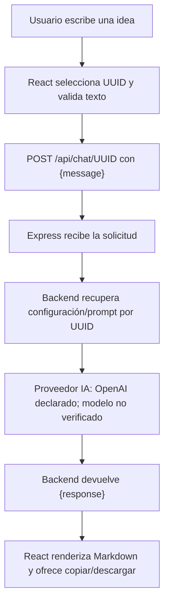
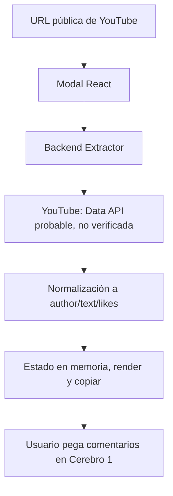
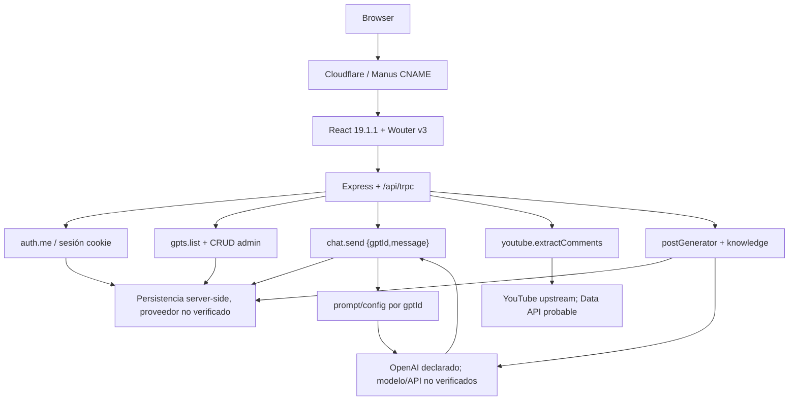

# Arquitectura técnica de COPA — segunda fase

**Fecha:** 12 de agosto de 2026  
**Método:** navegación anónima, bundles/recursos públicos y solicitudes que corresponden a funciones normales. No se creó una cuenta, no se alteraron IDs y no se ejecutaron pruebas ofensivas.

## Resultado principal

Hay dos implementaciones públicas coexistentes:

| Superficie | Frontend | API | Identificador de Cerebro | Sesión observable | Infraestructura |
|---|---|---|---|---|---|
| `app.pilasacademy.com` | React 18.3.1 + Wouter | REST `/api/*` | UUID | token Bearer desde `localStorage` cuando existe | Google Frontend / Express |
| `app.copa.pilasacademy.com` | React 19.1.1 + Wouter v3 | tRPC sobre `/api/trpc` | entero en `/dashboard/:gptId` | `credentials: "include"`; cookie de sesión inferida | CNAME `cname.manus.space`, Cloudflare / Express |

La segunda no es un simple alias visual. Es una replatformización con otro bundle, otras rutas, otro transporte API, otro esquema de IDs y otro mecanismo de sesión. Los hallazgos de la primera fase siguen describiendo el dominio heredado; no deben extrapolarse sin más al dominio nuevo.

## 1. Bundles y archivos públicos

### Nueva aplicación

- JavaScript principal: `https://app.copa.pilasacademy.com/assets/index-xW5uFPHl.js` (1,534,219 bytes en la descarga inspeccionada).
- CSS principal: `https://app.copa.pilasacademy.com/assets/index-AsxuMRhm.css` (162,557 bytes).
- El HTML incluye un runtime de Manus y referencias `data-loc` a archivos fuente como `client/src/pages/Dashboard.tsx`; no se obtuvo código servidor.
- `robots.txt`, `sitemap.xml`, `manifest.json` y `site.webmanifest` no son documentos válidos en esta versión: el servidor devuelve el fallback HTML de la SPA con el mismo bundle.
- Las rutas antiguas `/api/gpts`, `/api/content-gpts` y `/api/tutorials` también caen al HTML de la SPA en el dominio nuevo; la API real es tRPC.

### Búsqueda de términos en el bundle nuevo

| Término | Resultado relevante |
|---|---|
| `openai` | 1 referencia funcional: la UI del Generador de Posts dice estar conectada a OpenAI |
| `gpt-4`, `gpt-5`, `temperature`, `max_tokens`, `response_format`, `chat/completions`, `responses` | 0 referencias |
| `model` | Coincidencia de KaTeX (`\models`), no un nombre de modelo IA |
| `prompt` | UI promocional, prompt de instrucciones estático y formularios admin `Prompt del Sistema` |
| `assistant` | Roles de mensajes (`assistant`) y textos de UI |
| `youtube` / `extractor` | Procedimiento `youtube.extractComments`, modal y presentación comercial |
| Firebase, Supabase, PostgreSQL, MongoDB, Firestore, JWT, Auth0, Clerk | 0 referencias funcionales |
| Prisma | Sólo nombre de lenguaje del resaltador de código; no evidencia de ORM |

No se encontraron secretos publicables. Este informe no reproduce los prompts completos que el dominio heredado devuelve.

## 2. Proveedor y modelo IA

La atribución a OpenAI queda respaldada por la política ya documentada y por el texto de la nueva UI del Generador de Posts. En cambio, ninguno de los dos bundles, las cabeceras de respuesta ni las respuestas normales de chat revelan:

- nombre de modelo;
- API de OpenAI empleada;
- temperatura;
- límites de tokens;
- tools/functions;
- `response_format`;
- política de fallback.

`MODELO OPENAI: NO VERIFICADO`

Tampoco se puede verificar si usa Responses API, Chat Completions o Assistants API. El frontend nunca llama a OpenAI directamente: llama al backend propio.

## 3. API heredada relevante

| Método | Ruta | Finalidad | Request | Response observada/esperada | Auth | Cerebro |
|---|---|---|---|---|---|---|
| GET | `/api/gpts` | Catálogo marketing | — | 28 objetos `{id,name,prompt,order,isFree,category,...}` | No | 28 UUID |
| GET | `/api/content-gpts` | Catálogo contenido | — | 5 objetos equivalentes | No | 5 UUID |
| POST | `/api/chat/:gptId` | Generación genérica | `{message:string}` | `{response:string}`; el cliente admite IDs de conversación/mensajes | Free sin token; premium según membresía | Todos los Cerebros |
| GET | `/api/conversations/:gptId` | Historial | — | `{conversationId,messages}` | Opcional/usuario | Cerebro seleccionado |
| POST | `/api/extract-comments` | Extraer comentarios | `{url:string}` | `{comments:[{author,text}],total}` | No observado | Herramienta, no Cerebro |
| POST | `/api/generate-html-pilas` | Generación HTML híbrida | Campos de página | HTML/resultado de generación | Protegida | Herramienta |
| GET/DELETE | `/api/html-generations` | Historial HTML | según operación | registros/confirmación | Protegida | Herramienta |
| POST | `/api/tools/calculadora-ads` | Cálculo/diagnóstico de Ads | métricas | cálculo | Según UI | Herramienta |

La prueba normal al UUID Free `1b4dbcea-…` devolvió `200`, `Content-Type: application/json`, `X-Powered-By: Express` y únicamente `{response}`. No hubo cabecera de modelo.

## 4. API nueva: tRPC

### Transporte

El cliente crea un único enlace:

```text
/api/trpc
credentials: include
transformer: SuperJSON
```

Las queries viajan por GET y las mutations por POST. En modo batch, la respuesta tiene envoltura aproximada:

```json
[{"result":{"data":{"json":{}}}}]
```

No significa que todos los Cerebros compartan una sola operación HTTP fija. Comparten la misma puerta tRPC, pero el nombre lógico de la operación forma parte de la ruta, por ejemplo `chat.send` o `youtube.extractComments`.

### Operaciones observables

| Método | Operación bajo `/api/trpc` | Finalidad | Request visible en cliente | Response usada por cliente | Auth aparente | Relación |
|---|---|---|---|---|---|---|
| GET | `auth.me` | Sesión actual | `null` | usuario o `null` | Pública | auth |
| POST | `auth.login` | Login | `{email,password}` | éxito/error; luego refetch de `auth.me` | Pública | auth |
| POST | `auth.logout` | Cerrar sesión | vacío | éxito | Sesión | auth |
| POST | `auth.activate` | Activar cuenta | `{token}` | éxito/error | Pública | usuarios |
| POST | `auth.requestPasswordReset` | Solicitar reset | `{email}` | éxito genérico | Pública | usuarios |
| POST | `auth.resetPassword` | Cambiar contraseña | `{token,newPassword}` | éxito/error | Pública con token válido | usuarios |
| GET | `gpts.list` | Catálogo autorizado | vacío | array de Cerebros; anónimo devolvió `[]` | Sesión para contenido | todos |
| GET | `gpts.getForEdit` | Cargar prompt para admin | `{id}` | `{id,name,description,prompt,isFree,...}` | Admin | configuración |
| POST | `gpts.create` | Crear Cerebro | `{name,description,prompt,isFree}` | registro/éxito | Admin | configuración |
| POST | `gpts.update` | Editar Cerebro | `{id,name,description,prompt,isFree}` | éxito | Admin | configuración |
| POST | `gpts.delete` | Eliminar Cerebro | `{id}` | éxito | Admin | configuración |
| POST | `gpts.moveUp` / `moveDown` | Reordenar | `{id}` | éxito/error | Admin | catálogo |
| GET | `chat.getConversation` | Leer historial | `{gptId}` | `{messages:[...]}` | Usuario | Cerebro seleccionado |
| POST | `chat.send` | Generar | `{gptId,message}` | éxito; el cliente refetcha conversación | Usuario y plan | Cerebro seleccionado |
| POST | `chat.deleteConversation` | Borrar historial propio | `{gptId}` | éxito | Usuario | Cerebro seleccionado |
| POST | `youtube.extractComments` | Extraer comentarios | `{videoUrl}` | `{comments:[{author,text,likes}],videoId}` | Funcionó anónimamente | herramienta |
| GET | `tutorials.list` | Tutoriales | vacío | array; anónimo devolvió `[]` | Pública | ayuda |
| GET/POST | `admin.users.*` | Listar/crear/editar usuarios | `create:{name,email,password,plan,expirationDate}`; cambios de plan/role por `userId`; delete `{userId}` | usuarios/éxito | Admin | usuarios/membresía |
| GET/POST | `postGenerator.*` | Estructuras, conocimiento y posts | generación `{structureId,tema}`; CRUD de estructuras/conocimiento | `{content}` y colecciones | Admin | herramienta B |

Otras rutas literales del servidor: `/api/oauth/callback` y `/api/hotmart-webhook`. No se llamaron porque no forman parte de una acción anónima necesaria para esta investigación.

### ¿Un backend por Cerebro?

La evidencia favorece un **router común**:

```text
chat.send({ gptId, message })
```

No hay una operación tRPC distinta por Cerebro ni endpoints especializados de análisis, landing o funnel. Las diferencias se almacenan en registros con `name`, `description`, `prompt`, `isFree` y orden. YouTube y Post Generator sí tienen routers separados porque añaden procesamiento propio.

## 5. Dónde viven las instrucciones

La nueva aplicación permite determinar el flujo con bastante precisión:

1. El formulario admin crea/actualiza un registro con `prompt` bajo `gpts.create`/`gpts.update`.
2. La lista normal consume `gpts.list`; un endpoint separado `gpts.getForEdit` entrega el prompt sólo al editor admin.
3. El chat envía únicamente `{gptId,message}`; no envía el prompt.
4. Por tanto el backend debe resolver el `gptId` contra almacenamiento server-side antes de llamar al proveedor IA.

Clasificación:

- **A. Frontend:** hay un documento estático de instrucciones para llevar resultados a Manus, pero no es el prompt individual de cada Cerebro.
- **B. Backend:** sí; el backend recibe el ID y realiza la llamada IA.
- **C. OpenAI:** no hay evidencia de Assistants almacenados en OpenAI.
- **D. Base de datos:** muy probable y casi necesaria por CRUD, IDs enteros, orden, roles, planes e historial; el motor concreto no está verificado.
- **E. Combinación:** la mejor descripción es **backend + base de datos**, con instrucciones auxiliares estáticas en frontend.

En el dominio heredado la arquitectura era equivalente, pero `/api/gpts` entregaba además el campo `prompt` al navegador anónimo.

## 6. Flujo completo de un Cerebro

Se usó legítimamente el Cerebro Free `VALIDA SI TU IDEA ES UN PAU` del dominio heredado.



La respuesta aplicó exactamente los cuatro criterios configurados para el Cerebro y produjo veredicto/recomendaciones. Transformaciones adicionales verificadas de COPA:

- selección y recuperación del prompt por ID;
- control Free/VIP;
- límite de longitud en cliente (50.000 caracteres en la app nueva);
- persistencia/refetch de conversación para usuarios;
- render Markdown, copiado, descarga y borrado de historial;
- notas manuales por Cerebro.

No se verificó scoring algorítmico, búsqueda externa, RAG, tool calling ni transformación de dominio aparte del prompt/LLM.

## 7. Extractor de YouTube

### Flujo y endpoints



| Aspecto | Evidencia | Conclusión |
|---|---|---|
| Ubicación | El cliente sólo manda URL/videoUrl | Backend |
| Límite | Dos ejecuciones heredadas y una nueva devolvieron exactamente 500 | Cap de 500 confirmado en el video probado |
| Determinismo | Las dos respuestas heredadas tuvieron el mismo SHA-256 y orden | Estable en ejecuciones consecutivas |
| Nueva vs heredada | Mismos 500 autores en el mismo orden; 496/500 textos coinciden tras decodificar HTML | Misma fuente/lógica aguas arriba con normalización distinta |
| Formato nuevo | `author`, `text`, `likes`, `videoId`; texto contiene entidades, `<a>` y `<br>` | Compatible con `textDisplay` de YouTube |
| Duplicados | 0 grupos exactos `author+text`; 4 grupos de texto repetido | No prueba una deduplicación implementada |
| Almacenamiento | Respuesta directa; el modal mantiene array en estado y copia al portapapeles | No se observó persistencia |
| IA | No hay campos de análisis ni llamada IA en el flujo extractor | No se observó IA durante extracción |

### Data API, scraping o tercero

La hipótesis más fuerte es **YouTube Data API v3 `commentThreads.list`**, porque:

- la documentación oficial expone `authorDisplayName`, `textDisplay` y `likeCount`, que corresponden directamente a `author`, `text` y `likes`;
- `textDisplay` puede ser HTML y el formato nuevo conserva enlaces y `<br>`;
- la API permite 100 resultados por página y `nextPageToken`; llegar a 500 sería compatible con cinco páginas;
- `commentThreads.list` permite `order=time` o `order=relevance`.

Fuentes: [CommentThreads: list](https://developers.google.com/youtube/v3/docs/commentThreads/list), [Comments resource](https://developers.google.com/youtube/v3/docs/comments).

Sin embargo, ni el bundle ni una cabecera de Network muestran `googleapis.com`, una clave, una librería o un proveedor tercero. Por ello:

`MÉTODO DEL EXTRACTOR: DATA API V3 PROBABLE, NO VERIFICADA`

### Selección, replies, orden y paginación

- **Selección:** 500 comentarios devueltos por el orden del upstream; no hay filtro configurable en el cliente.
- **Orden:** determinista en dos llamadas consecutivas, pero no se puede elegir ni verificar `time` frente a `relevance`.
- **Paginación:** probable por el cap 100 de Data API, no observable directamente porque COPA colapsa todo en una respuesta.
- **Replies:** no hay `parentId`, `replyCount` ni información de hilo; no se puede demostrar que las preserve. Aunque el upstream las obtuviera, la salida pierde la relación.
- **Deduplicación:** no verificable. El único corpus no tenía duplicados exactos y sí textos repetidos.
- **Persistencia:** no observada.
- **Análisis IA:** no observado; es extracción/normalización programática.

## 8. Usuarios, membresía y persistencia

### Nueva aplicación

- Login con `{email,password}`.
- `auth.me` devuelve el usuario de sesión; el fetch usa `credentials: include`.
- No existe token Bearer ni JWT de aplicación en `localStorage`; sólo tema y un dato auxiliar del runtime Manus.
- Roles visibles: `user` y `admin`.
- Planes visibles: `free`, `vip`, `vip_readonly`; los usuarios admin pueden asignar plan y fecha de expiración.
- Activación por `?token=` y recuperación de contraseña con token de URL.
- Historial server-side por usuario y `gptId`, con lectura y borrado.
- Las notas del dashboard nuevo viven sólo en estado React; permiten copiar/descargar, pero no se observó guardado ni `localStorage`.
- El Generador de Posts tiene estructuras y una base de conocimiento administrable; la UI afirma 263 entradas.

### Dominio heredado

- Token en `localStorage` y cabecera Bearer.
- Conversaciones e historial server-side.
- Notas y campos auxiliares en `localStorage`.

### Proveedor de datos

No hay evidencia pública funcional de Firebase, Supabase, PostgreSQL, MongoDB, Cloud SQL, Firestore, Auth0, Clerk o Google Identity. Los CRUD y IDs prueban almacenamiento persistente, pero no el producto concreto.

## 9. Clasificación técnica

- **33/33 registros verificables:** A — Prompt + LLM.
- **0/33:** B — no se verificó procesamiento especializado por Cerebro.
- **0/33:** C — las herramientas programáticas no están registradas como Cerebros.
- **Nombres promocionales/históricos sin configuración:** D o A probable, según el inventario.

Herramientas especializadas separadas:

- Extractor de YouTube: **C**.
- Calculadora de Ads: **C**.
- Generación HTML: **B**.
- Generador de Posts con estructuras/base de conocimiento: **B**.

Por tanto, dentro de los 33 Cerebros enumerables no se verificó que ninguno requiera backend especializado distinto del router genérico. El software especializado aparece como herramientas auxiliares separadas.

## 10. Arquitectura reconstruida



El dominio heredado mantiene en paralelo React 18 + REST + Google Frontend y un catálogo UUID de 33 registros.

## 11. Seguridad pasiva

No se realizaron SQL injection, prompt injection, XSS, IDOR, SSRF, bypass de autenticación, manipulación de tokens, fuerza bruta, llamadas admin, evasión de paywall ni explotación.

### POSIBLE VULNERABILIDAD — NO EXPLOTADA

**Exposición de configuración en el dominio heredado.** `GET /api/gpts` y `GET /api/content-gpts` entregan anónimamente el campo `prompt` de registros que la UI marca como premium. Se accedió únicamente a esos endpoints públicos que el cliente consume; no se reprodujeron los prompts ni se intentó usar contenido bloqueado. La nueva aplicación parece corregirlo: `gpts.list` anónimo devuelve `[]` y `gpts.getForEdit` está en la UI admin.

### POSIBLE VULNERABILIDAD — NO EXPLOTADA

**Render HTML de comentarios.** El bundle nuevo pinta `c.text` mediante `dangerouslySetInnerHTML`. Las respuestas normales observadas traen HTML generado/escapado por YouTube (`<a>`, `<br>`, entidades), pero desde la superficie pública no se puede verificar la sanitización server-side. No se publicó un comentario de prueba ni se intentó inyectar HTML/JavaScript. La evidencia sólo justifica revisar sanitización y una allowlist de etiquetas/atributos.

## 12. Resolución de 33 vs 47

- 33 registros actuales verificables en la API REST heredada.
- La app nueva dice `+30`, no 47, y no incrusta una lista fija.
- 17 huecos de `order` y 17 nombres históricos retirados/consolidados explican la sensación de un catálogo mayor a lo largo del tiempo.
- Los valores `order=47`, `48` y `49` son posiciones, no prueba de 50 activos.
- No hay manifest, sitemap, bundle o respuesta pública con 47 Cerebros simultáneos.

**Veredicto:** `47 CEREBROS EN EL CÓDIGO ACTUAL: NO VERIFICADO Y NO RESPALDADO POR LA SUPERFICIE PÚBLICA`.

El detalle fila por fila está en `COPA_BRAINS_INVENTORY.md`; lo que sigue abierto está en `COPA_OPEN_QUESTIONS.md`.
