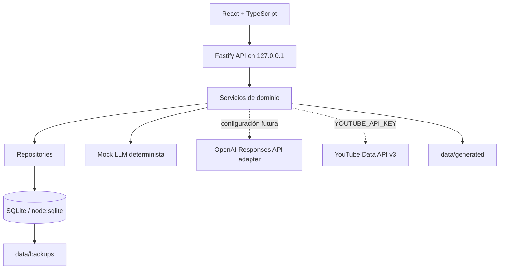

# Informe final de construcción

## Resultado

La plataforma queda operativa como aplicación local de un usuario. Puede crear proyectos manuales o ejecutar un recorrido `DEMO` completo y persistente sin claves. Los módulos se conectan mediante IDs, snapshots, versiones y lineage; no requieren copiar y pegar resultados.

## Arquitectura



Backend y frontend compilado se sirven desde el mismo origen en producción local. Fastify valida contratos compartidos TypeBox. SQLite aplica foreign keys, constraints compuestos por proyecto y migraciones transaccionales.

## Módulos y flujo

El workflow persistente contiene 14 etapas: Research, Sources, Problems, Opportunities, Product, Avatar, Mechanism, Beliefs, Offer, Landing, Funnel, Emails, Content y Final Product.

- Research entrega subnichos, hipótesis, preguntas, búsquedas e insights.
- Sources admite Demo, texto manual y YouTube.
- Problems agrupa problemas y conserva `evidenceIds` y citas.
- Opportunities puntúa ocho dimensiones 0–100 con rationale y confianza.
- Product genera una propuesta estructurada.
- Avatar distingue evidencia de inferencia.
- Mechanism, Beliefs y Offer construyen el razonamiento comercial.
- Landing genera copy estructurado y HTML responsive sanitizado.
- Funnel genera nodos/aristas sin pagos reales.
- Emails y Content generan secuencias/calendario estructurados.
- Final Product genera Guide, Checklist, Workbook y Mini HTML Tool.

Cada módulo obtiene automáticamente las versiones padre requeridas, rechaza dependencias ausentes u obsoletas, persiste su snapshot, crea lineage y actualiza el workflow.

## Base de datos y migraciones

- Migración 001: Projects y base inicial.
- Migración 002: settings, workflow, artifacts, artifact versions, lineage, stale events y backups.
- Migración 003: sources, videos, comments, evidence snippets, jobs, generations, llm usage y generated files.
- Migración 004: guards de aislamiento por proyecto para versiones, lineage y staleness.
- Migración 005: guards de `active_version_id` y updates de relaciones.

Las relaciones compuestas y los guards de schema impiden cruzar entidades entre proyectos. El borrado permanente requiere confirmación exacta y utiliza cascadas. Backups validan integridad y versión antes de restaurar, crean primero una copia de seguridad del estado actual e incluyen un sidecar de `data/generated`.

## Versioning, lineage y stale

Los outputs se guardan como `ArtifactVersion`. Una nueva versión conserva la anterior como `superseded`; sus descendientes se marcan `stale` con causa persistida. Se admiten múltiples padres. La validación bloquea artefactos o padres pertenecientes a otro proyecto.

## Evidence

Cada comentario Demo, manual o YouTube produce un `evidence_snippet` con procedencia. Los outputs distinguen `EVIDENCE_BACKED` de `AI_INFERENCE`. El corpus Demo usa datos sintéticos y está marcado visualmente.

## Integraciones

- Mock LLM: `PASS`. Determinista, sin red, tokens estimados y coste cero.
- OpenAI Responses API: `IMPLEMENTED_NOT_LIVE_VERIFIED`. Maneja timeout, red, auth, rate limit, cuota, JSON inválido y schema mismatch. No se conecta automáticamente desde UI sin configuración explícita.
- YouTube Data API: `IMPLEMENTED_NOT_LIVE_VERIFIED` en vivo; recorrido completo `PASS` con adaptador simulado. Pagina sin límite artificial de 500, recupera replies faltantes, deduplica y persiste progreso.

## Jobs, historial y costes

YouTube utiliza jobs `QUEUED/RUNNING/COMPLETED/FAILED/CANCELLED`, con checkpoint por página, cancelación cooperativa, retry y recuperación tras reinicio. Cada generación persiste provider, model, tokens, coste estimado, duración, agente y proyecto. Historial muestra generaciones y jobs.

## Archivos generados

Landing exporta HTML/CSS portable y escapado. Final Product exporta cuatro archivos: `guide.md`, `checklist.md`, `workbook.md` y `mini-tool.html`. La UI lista descargas, tamaño y checksum SHA-256. Los paths se resuelven dentro de `data/generated`.

## QA ejecutado

| Verificación | Estado |
|---|---|
| TypeScript shared/server/web | PASS |
| Unit + integration + E2E | PASS — 32/32 |
| Build backend | PASS |
| Build frontend | PASS |
| Migraciones hasta schema 5 | PASS |
| Demo 14/14 módulos | PASS |
| Persistencia tras reinicio | PASS |
| Export HTML/final files | PASS |
| npm audit | PASS — 0 vulnerabilidades |
| QA visual desktop | PASS |
| Consola browser | PASS — sin errores/warnings |
| Responsive 390×844 | PASS — sin overflow horizontal |

La revisión inicial encontró un defecto HIGH que permitía lineage cruzado entre proyectos; fue corregido y tiene test de regresión. La revisión independiente final rechazó primero el release por salidas fijas, trazabilidad débil, scoring no reproducible, invalidación incompleta, backups parciales y falta de atomicidad. Tras dos rondas de corrección, el tercer gate independiente terminó `PASS`, sin CRITICAL/HIGH ni regresiones nuevas.

## Multiagente

Se trabajó en paralelo con responsables de Backend/Data, Frontend/UX y AI/Integrations. El orquestador revisó contratos, integró cambios, corrigió conflictos compartidos y ejecutó las verificaciones globales. Se solicitó además una revisión QA independiente final.

## Seguridad local

La app escucha sólo en `127.0.0.1`, no incorpora auth ni exposición pública, valida payloads y IDs, usa consultas preparadas, no renderiza HTML del LLM con `dangerouslySetInnerHTML` y escapa los exports HTML. `.env`, bases y datos generados están ignorados por Git. No se realizaron pruebas ofensivas contra terceros.

## API keys

No son necesarias para Demo. Para integraciones reales consulta `API_KEYS_TODO.md`. No se creó, leyó ni almacenó ninguna clave real.

## Problemas conocidos

No hay defectos CRITICAL o HIGH conocidos. Las limitaciones de producto no críticas están enumeradas en `KNOWN_ISSUES.md`.

## Arranque

```powershell
npm.cmd install
npm.cmd run dev
```

Abrir `http://127.0.0.1:5173` y pulsar **Crear proyecto Demo**.

Para producción local:

```powershell
npm.cmd run build
npm.cmd start
```

Abrir `http://127.0.0.1:4310`.
