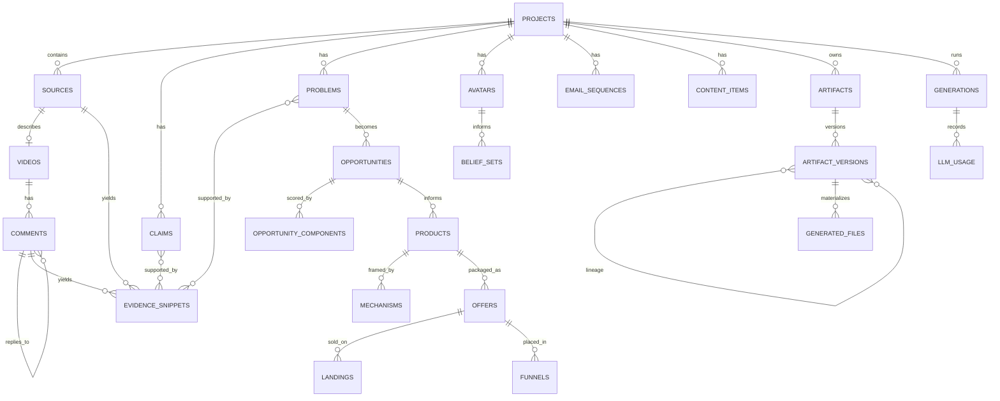

# Modelo de datos local

**Motor:** SQLite embebida  
**Estado:** modelo lógico; las migraciones todavía no existen  
**Objetivo:** datos normalizados, versionados y trazables sin convertir SQLite en un almacén de JSON opaco.

## 1. Convenciones

- Todos los IDs de dominio son UUID v7 representados como texto. Son estables en exportaciones y no revelan una secuencia global.
- Todos los timestamps se guardan en UTC y la UI los localiza.
- Cada tabla de dominio incluye `project_id` cuando esto permite validar pertenencia sin joins ambiguos.
- Campos extensibles pueden usar JSON, pero las relaciones y propiedades consultables se normalizan.
- Los enums se validan en la aplicación y, cuando sea práctico, con `CHECK` de SQLite.
- `created_at`, `updated_at` y `created_by` (`user`, `system`, `llm`) se aplican a entidades editables.
- Borrado normal es archivado/soft delete. Evidencia usada por lineage no se elimina físicamente desde la UI.
- Las claves foráneas y unicidad se hacen cumplir en base de datos.

## 2. Vista general

El diagrama muestra las relaciones principales. Las tablas de detalle se enumeran a continuación.

## 3. Proyectos y configuración

### 3.1 `projects`

| Campo | Tipo lógico | Regla |
|---|---|---|
| `id` | UUID text | PK |
| `name` | text | obligatorio |
| `niche` | text | obligatorio al iniciar investigación |
| `description` | text | opcional |
| `status` | enum | `active`, `archived` |
| `language` | text | por defecto `es` |
| `region` | text | opcional |
| `currency` | text | código configurado por usuario |
| `default_model_profile_id` | UUID | FK opcional |
| `cost_budget_amount` | decimal text | informativo, opcional |
| `created_at`, `updated_at`, `archived_at` | timestamp | auditoría |

### 3.2 `project_settings`

Una fila por proyecto: límites de contexto, parámetros de extracción, pesos de scoring activos, directorio de exportación, preferencias de estilo y feature flags locales. Los valores sensibles no se guardan aquí.

### 3.3 `project_selections`

Mantiene la decisión activa del usuario sin sobreescribir historial.

| Campo | Regla |
|---|---|
| `project_id` | FK |
| `selection_type` | `primary_opportunity`, `primary_product`, `primary_avatar`, `primary_mechanism`, `primary_belief_set`, `primary_offer`, `primary_landing`, `primary_funnel` |
| `entity_id` | ID validado por aplicación y artifact version |
| `artifact_version_id` | FK a versión aprobada |
| `selected_at` | timestamp |

Único por `(project_id, selection_type)`; el cambio previo queda en `selection_history`.

## 4. Fuentes, videos y comentarios

### 4.1 `sources`

Representa cualquier fuente investigada.

| Campo | Descripción |
|---|---|
| `id`, `project_id` | identidad y pertenencia |
| `source_type` | `youtube`, `web`, `manual_note`, `file_import`, `other` |
| `title`, `url`, `publisher` | metadata visible |
| `status` | `suggested`, `verified`, `imported`, `unavailable`, `archived` |
| `retrieved_at` | cuándo se obtuvo realmente |
| `content_hash` | detección de cambios/duplicados |
| `original_file_path` | ruta relativa dentro de datos |
| `notes` | comentarios del usuario |

Una fuente sugerida por IA comienza como `suggested`; sólo pasa a `verified/imported` por una acción real.

### 4.2 `videos`

| Campo | Descripción |
|---|---|
| `id`, `project_id`, `source_id` | `source_id` único |
| `platform` | inicialmente `youtube` |
| `platform_video_id` | único por plataforma/proyecto |
| `channel_id`, `channel_title` | metadata |
| `title`, `description` | metadata recuperada |
| `published_at` | fecha del video |
| `comment_count_reported` | dato reportado por plataforma |
| `duration`, `etag` | opcionales |
| `last_synced_at` | último sync exitoso |

### 4.3 `comment_threads`

Conserva el hilo aunque la salida de una API mezcle replies:

- `id`, `project_id`, `video_id`;
- `platform_thread_id` único;
- `top_level_comment_id` opcional hasta completar la página;
- `total_reply_count_reported`;
- `etag`, `last_synced_at`.

### 4.4 `comments`

| Campo | Descripción |
|---|---|
| `id`, `project_id`, `video_id`, `thread_id` | identidad/relaciones |
| `parent_comment_id` | self FK para reply |
| `platform_comment_id` | único por plataforma |
| `comment_type` | `top_level`, `reply` |
| `author_display_name` | autor público visible |
| `author_channel_id` | opcional; no se usa para perfilar |
| `text_original` | texto preservado |
| `text_normalized` | sólo búsqueda/dedupe; nunca sustituye al original |
| `like_count` | entero no negativo |
| `published_at`, `updated_at_platform` | fechas de plataforma |
| `is_public`, `is_deleted_at_source` | estado de sincronización |
| `content_hash` | respaldo de dedupe |
| `import_run_id` | corrida que lo creó/actualizó |

Índices: video/fecha, thread, parent, hash, búsqueda de texto. Unicidad principal `(platform, platform_comment_id)` mediante campo de plataforma o relación al video.

### 4.5 `youtube_import_runs` y `youtube_import_pages`

`youtube_import_runs` registra parámetros explícitos, estado, conteos, cuota estimada, cursor final, errores y timestamps. `youtube_import_pages` registra cursor de entrada/salida, número de items, checksum y estado de cada página. Permite reanudar sin fingir atomicidad de toda una extracción larga.

## 5. Evidencia, hallazgos y claims

### 5.1 `evidence_snippets`

Unidad canónica de evidencia:

| Campo | Descripción |
|---|---|
| `id`, `project_id` | identidad |
| `source_id` | fuente obligatoria |
| `comment_id` | opcional; si existe debe corresponder a la fuente/video |
| `quote_text` | fragmento exacto |
| `locator` | timestamp, párrafo, URL fragment o descriptor |
| `quote_hash` | integridad y dedupe |
| `captured_by` | usuario, importador o agente |
| `verified_at` | verificación humana opcional |

### 5.2 `claims`

Una afirmación reutilizable y trazable.

- `id`, `project_id`;
- `claim_type`: `finding`, `problem`, `avatar_attribute`, `mechanism`, `belief`, `benefit`, `marketing`, `other`;
- `statement`;
- `provenance_class`: `observed`, `calculated`, `ai_inference`, `user_assertion`;
- `confidence` 0–1 o `unknown`;
- `status`: draft/approved/rejected/archived;
- `generation_id` y `artifact_version_id` opcionales.

### 5.3 `claim_evidence`

Many-to-many entre claim y evidence:

- `claim_id`, `evidence_snippet_id` como PK compuesta;
- `relation`: `supports`, `contradicts`, `illustrates`, `mentions`;
- `strength` opcional;
- `notes`.

### 5.4 Investigación

- `research_questions`: pregunta, prioridad, estado, respuesta/claim opcional.
- `search_queries`: texto, plataforma sugerida, estado, fecha de ejecución manual.
- `research_findings`: título, resumen, claim_id, estado y versión.
- `finding_evidence`: relación explícita si se requiere presentación específica; la verdad probatoria sigue en `claim_evidence`.

## 6. Problemas y evidencia

### 6.1 `problems`

| Campo | Descripción |
|---|---|
| `id`, `project_id` | identidad |
| `name`, `summary`, `category` | descripción estructurada |
| `claim_id` | claim principal |
| `status` | draft/approved/etc. |
| `frequency_count` | número de unidades deduplicadas |
| `frequency_denominator` | universo analizado |
| `frequency_rate` | valor calculado |
| `confidence` | calidad global |
| `artifact_version_id` | versión que lo contiene |

### 6.2 `problem_evidence`

Relación many-to-many explícita solicitada:

- `problem_id`, `evidence_snippet_id`;
- `evidence_role`: `primary`, `representative_quote`, `desire`, `objection`, `attempted_solution`, `language`, `counterexample`;
- `relevance_score`;
- `assigned_by`.

### 6.3 `problem_attributes`

Guarda elementos repetibles normalizados: tipo (`frustration`, `desire`, `question`, `attempted_solution`, `objection`, `language_pattern`), texto, claim ID y orden.

### 6.4 `analysis_sets`

Define el universo exacto de comentarios/fuentes analizados. `analysis_set_items` enlaza cada source/comment. Esto evita comparar frecuencias calculadas sobre denominadores invisibles.

## 7. Oportunidades y scoring

### 7.1 `score_formulas`

Versiona la fórmula: nombre, versión, estado y política ante datos desconocidos. `score_formula_components` guarda key, label, weight basis points, dirección y reglas de normalización. Los pesos activos suman 10 000 basis points.

### 7.2 `opportunities`

- `id`, `project_id`, `problem_id`;
- `name`, `summary`;
- `formula_id`;
- `total_score` 0–100;
- `confidence`;
- `rank` dentro de un evaluation run;
- `status` y `artifact_version_id`.

### 7.3 `opportunity_components`

| Campo | Descripción |
|---|---|
| `opportunity_id`, `formula_component_id` | identidad compuesta |
| `value` | 0–100 o null |
| `normalized_value` | después de regla |
| `weighted_value` | contribución determinista |
| `provenance_class` | calculado/inferencia/usuario |
| `confidence` | 0–1 |
| `rationale` | explicación |
| `generation_id` | si intervino LLM |

`opportunity_component_evidence` enlaza cada componente con evidencia. `opportunity_evidence` permite evidencia general. `opportunity_evaluation_runs` fija conjunto de problemas, fórmula y ranking para comparaciones reproducibles.

## 8. Producto

### 8.1 `products`

- `id`, `project_id`, `opportunity_id`;
- `name`, `concept`, `promise`, `format`, `scope`, `status`;
- `artifact_version_id`.

### 8.2 Detalles normalizados

- `product_outcomes`: resultados previstos y claim IDs.
- `product_modules`: posición, título, objetivo y resultado.
- `product_lessons`: opcional, hijo de módulo.
- `product_resources`: type (`checklist`, `template`, `guide`, `tool`, `bonus`, `other`), nombre, descripción, estado y file ID opcional.
- `product_assumptions` y `product_risks`.

## 9. Avatar

### 9.1 `avatars`

Contiene nombre de trabajo, segmento, resumen, estado y versión.

### 9.2 `avatar_attributes`

| Campo | Descripción |
|---|---|
| `avatar_id` | FK |
| `attribute_type` | situation, goal, pain, frustration, desire, objection, language, behavior, motivation, purchase_context, unknown |
| `statement` | contenido |
| `claim_id` | procedencia/confianza |
| `priority`, `sort_order` | presentación |

`avatar_evidence` enlaza atributo o avatar con evidence. No hay campos demográficos obligatorios.

## 10. Mecanismos, creencias y tesis

### 10.1 `mechanisms`

- `id`, `project_id`, `product_id`, `avatar_id`;
- `perceived_problem`, `proposed_root_cause`, `solution_mechanism`, `simple_explanation`;
- `confidence`, `status`, `artifact_version_id`.

Tablas hijas: `mechanism_differentiators`, `mechanism_alternatives`, `mechanism_assumptions`, `mechanism_evidence` con rol supports/contradicts.

### 10.2 `belief_sets`

- `id`, `project_id`, `avatar_id`, `mechanism_id`, `product_id`;
- `central_thesis`, claim_id, status y artifact version.

### 10.3 `beliefs`

- `belief_set_id`;
- `belief_type`: limiting, required, objection;
- `statement`, claim_id, priority, status.

`belief_transitions` enlaza una creencia limitante con una requerida y describe el puente argumental. `belief_evidence` conserva sustento o contradicción.

## 11. Ofertas

### 11.1 `offers`

- `id`, `project_id`, `product_id`, `avatar_id`, `mechanism_id`, `belief_set_id`;
- `name`, `offer_type`: core/order_bump/upsell/downsell;
- `parent_offer_id` para extensiones;
- `price_amount` como decimal exacto, `currency`;
- `price_rationale`, `guarantee_text`, `status`, `artifact_version_id`.

### 11.2 Detalles

- `offer_deliverables`: referencia opcional a product resource.
- `offer_benefits`: claim ID y product outcome ID opcionales.
- `offer_bonuses`.
- `offer_objection_responses`.
- `offer_assumptions`.

No hay tabla de transacciones o clientes: la plataforma no procesa pagos.

## 12. Landings y prueba

### 12.1 `landings`

Identidad, offer ID, nombre, slug local, estado, tema y artifact version.

### 12.2 `landing_sections`

- `landing_id`, `section_type`, `sort_order`;
- headline, subheadline, body estructurado;
- CTA label/target local;
- settings de presentación permitidos.

### 12.3 `landing_assertions`

Enlaza fragmentos de una sección con `claim_id` y opcionalmente evidence snippet. Tipos: benefit, metric, testimonial, authority, guarantee, other. Una assertion `testimonial` no puede aprobarse sin evidencia verificada y fuente identificada.

### 12.4 `landing_previews`

Guarda versión del renderer, generated file ID, checksum, fecha y warnings de sanitización. El HTML no es la fuente de verdad; se regenera desde secciones.

## 13. Funnels

### 13.1 `funnels`

Proyecto, nombre, entry node, status y artifact version.

### 13.2 `funnel_nodes`

Tipos: landing, checkout_simulated, order_bump, upsell, downsell, thank_you. Referencia opcional a landing/offer y posición visual.

### 13.3 `funnel_edges`

`from_node_id`, `to_node_id`, evento (`continue`, `accept`, `decline`, `complete`) y condición estructurada. La validación impide referencias cruzadas y nodos inaccesibles.

## 14. Emails y contenido

### 14.1 `email_sequences`

Proyecto, offer/avatar/belief IDs, type, nombre, status y artifact version.

### 14.2 `emails`

Secuencia, posición, delay value/unit, subject, preheader, body, CTA, purpose y status. `email_claims` y `email_lineage_sources` mantienen vínculos semánticos.

### 14.3 `content_calendars`

Proyecto, nombre, channel, fechas y status.

### 14.4 `content_items`

- calendar ID opcional;
- type, channel, angle, hook, body, CTA;
- scheduled date, variation group, status;
- artifact version.

`content_item_claims` enlaza claims/evidencia. La plataforma no guarda estado “publicado” como hecho salvo futura integración real o confirmación manual.

## 15. Artefactos, versiones y lineage

### 15.1 `artifacts`

Registro estable de una unidad versionable.

| Campo | Descripción |
|---|---|
| `id`, `project_id` | identidad |
| `artifact_type` | research, problem_set, opportunity_set, product, avatar, mechanism, belief_set, offer, landing, funnel, email_sequence, content_batch, product_content |
| `domain_entity_id` | ID de la entidad raíz validado por servicio |
| `name` | etiqueta visible |
| `active_version_id` | versión aprobada/seleccionada actual |

### 15.2 `artifact_versions`

- `id`, `artifact_id`, `version_number` único;
- `status`: draft, approved, superseded, archived;
- `freshness`: fresh, stale;
- `schema_version`;
- `snapshot_json`: representación exportable de esa versión;
- `generation_id` opcional;
- `created_by`, timestamps, approval info y change summary.

El snapshot no reemplaza tablas normalizadas; permite auditoría/reproducción de la versión exacta.

### 15.3 `lineage_edges`

- `from_artifact_version_id`;
- `to_artifact_version_id`;
- `relation`: derived_from, selected_from, summarizes, transforms, renders;
- `generation_id` opcional;
- `context_inclusion`: full, summary, evidence_sample, metadata_only;
- PK/unique que evite duplicados.

La aplicación verifica que ambos artefactos pertenezcan al mismo proyecto y evita ciclos donde no estén permitidos.

### 15.4 `staleness_events`

Registra causa, versión upstream nueva, versión downstream afectada, fecha y resolución (`regenerated`, `reviewed_keep`, `superseded`). Esto evita que `stale` sea una bandera inexplicable.

## 16. Workflow y trabajos

### 16.1 `workflow_steps`

Una fila por proyecto y `step_key`. Guarda estado, readiness, active artifact version, bloqueadores, started/completed timestamps.

### 16.2 `workflow_dependencies`

Definición global/versionada: step upstream, downstream, required artifact type, obligatoriedad y estrategia de invalidación.

### 16.3 `jobs`

- ID, project ID, job type;
- status, priority, progress current/total/message;
- idempotency key;
- input snapshot ref;
- attempt count, timestamps, cancellation/error.

Los detalles específicos viven en import runs o generations, no en un JSON sin estructura.

## 17. Generaciones, prompts y costes

### 17.1 `generations`

| Campo | Descripción |
|---|---|
| `id`, `project_id`, `job_id` | identidad |
| `agent_key`, `agent_version` | contrato ejecutado |
| `prompt_version_id` | instrucciones efectivas |
| `provider_profile_id`, `model_profile_id` | routing solicitado |
| `provider_name`, `model_requested`, `model_reported` | auditoría no secreta |
| `input_snapshot_json` | contexto exacto o referencia a archivo si grande |
| `input_hash` | reproducibilidad/idempotencia |
| `output_json`, `output_text` | respuesta validada/redactada |
| `status`, `finish_reason`, `validation_status` | resultado |
| `started_at`, `completed_at`, `latency_ms` | tiempos |
| `retry_of_generation_id` | cadena de reintentos |
| `error_code`, `error_message_safe` | sin secretos |

### 17.2 `generation_inputs`

Enlaza generación con artifact versions, evidence snippets y entidades concretas. Campos: input type/id, artifact version, inclusion mode, token estimate y orden.

### 17.3 `prompt_versions`

Agent key, semver, hashes de system/task/schema, changelog, estado y fecha. Puede registrar rutas relativas, pero no secretos.

### 17.4 Proveedores y perfiles

- `provider_profiles`: nombre local, provider type, enabled; referencia al nombre de variable de entorno, nunca clave.
- `model_profiles`: economy/balanced/powerful o perfil propio, provider profile, model identifier y opciones permitidas.
- `pricing_versions`: provider/model, moneda, vigencia, unidad y precios input/output/cache introducidos o actualizados por usuario.

### 17.5 `llm_usage`

- generation ID;
- input, output, cached/read/write tokens cuando existan;
- estimated input/output tokens;
- cost amount, currency, cost status (`provider_reported`, `calculated`, `estimated`, `unknown`);
- pricing version ID;
- request count.

No se recalcula retroactivamente una generación histórica con una tarifa nueva.

## 18. Archivos generados

### 18.1 `generated_files`

- `id`, `project_id`, `artifact_version_id`;
- `file_role`, `format`, MIME type;
- ruta relativa segura;
- checksum, bytes;
- exporter key/version;
- source generation ID opcional;
- created at, validation status y warnings.

### 18.2 `file_lineage`

Enlaza archivo con múltiples artifact versions o resources. Permite responder qué versión produjo un PDF/HTML determinado.

## 19. Configuración y secretos

`app_settings` contiene preferencias no sensibles. `secret_references` puede guardar únicamente el alias de una variable, por ejemplo `OPENAI_API_KEY`, estado de configuración y fecha de última verificación; jamás el valor.

El MVP lee secretos desde `.env` backend. `.env` no se incluye en backup por defecto ni en exportación de proyecto.

## 20. Reglas de integridad críticas

1. Toda relación entre entidades debe pertenecer al mismo `project_id`.
2. Un evidence snippet apunta a una fuente real; si apunta a comentario, el quote debe ser verificable en su texto original.
3. Un claim observado no puede existir sin evidencia.
4. Un total de oportunidad sólo se guarda si coincide con fórmula, pesos y componentes persistidos.
5. Sólo una artifact version aprobada puede ser selección activa.
6. Una versión downstream conserva lineage a las versiones exactas, no sólo a entidades mutables.
7. Un cambio upstream no borra downstream: crea eventos de staleness.
8. Las generaciones fallidas no crean resultados aprobables parciales, salvo recuperación explícita como draft.
9. Una landing no aprueba assertions de prueba/testimonio sin evidencia verificada.
10. Un generated file nunca contiene una ruta absoluta proporcionada por el LLM.

## 21. Índices mínimos

- Todas las FKs relevantes.
- `sources(project_id, source_type, status)` y URL normalizada.
- `comments(video_id, published_at)`, platform comment ID y content hash.
- FTS/búsqueda sobre comments, evidence y claims si está disponible.
- `problem_evidence(problem_id, evidence_snippet_id)`.
- `opportunities(project_id, total_score)`.
- `artifact_versions(artifact_id, version_number/status/freshness)`.
- `lineage_edges(from...)` y `(to...)`.
- `generations(project_id, agent_key, started_at)`.
- `llm_usage(generation_id)`.
- `jobs(status, created_at)`.

## 22. Retención, exportación y migración

- Las versiones y generaciones se retienen por defecto; el usuario puede archivar.
- Datos brutos importados y comentarios no se editan destructivamente; normalizaciones van en campos separados.
- La exportación JSON incluye schema version, entidades, IDs, relationships y checksums.
- Cada migración crea un backup consistente antes de alterar la base.
- La importación valida versión y referencias en una base temporal/transacción antes de incorporar datos.

## 23. Preguntas a validar durante los spikes

- Compatibilidad real del driver SQLite elegido con Node.js 24 y Windows.
- Disponibilidad y comportamiento de FTS5 en ese driver.
- Rendimiento con corpus representativos de 10 000, 100 000 y 500 000 comentarios.
- Tamaño máximo práctico de snapshots JSON antes de moverlos a archivos content-addressed.
- Estrategia final para secretos: `.env` en MVP y, si conviene, Windows Credential Manager después.

Estas preguntas no cambian el modelo lógico; determinan detalles de implementación.
