# Plan de implementación incremental

> **STATUS: IMPLEMENTED HASTA FASE 17.** El cierre real está en [FINAL_BUILD_REPORT.md](FINAL_BUILD_REPORT.md), [docs/PHASE_16_REFINEMENT_REPORT.md](docs/PHASE_16_REFINEMENT_REPORT.md) y [docs/PHASE_17_KNOWLEDGE_ENGINE_REPORT.md](docs/PHASE_17_KNOWLEDGE_ENGINE_REPORT.md).

**Estado histórico:** planificación; no se ha creado código de producción
**Stack fijado:** React + TypeScript + Node.js + SQLite  
**Criterio:** cada fase debe dejar una capacidad pequeña, demostrable y probada antes de empezar la siguiente.

## 1. Estrategia

Se construirá un monolito modular verticalmente. Primero se validan los riesgos técnicos —SQLite en Node 24, versionado, lineage y jobs—; después se entrega el camino de evidencia a oportunidad; por último se agregan activos comerciales y exportadores.

No se empieza creando catorce pantallas ni prompts. Cada fase atraviesa, cuando corresponda, contrato → dominio → persistencia → API → UI → pruebas.

## 2. Definition of Done común

Una fase está terminada cuando:

- sus contratos están versionados y validados;
- hay migraciones reproducibles y rollback operativo mediante backup/restore, no migraciones inversas improvisadas;
- las reglas críticas tienen pruebas unitarias;
- el repositorio/API tienen pruebas de integración con una SQLite temporal;
- existe un recorrido UI verificable cuando la fase incluye interfaz;
- errores y estados vacíos son comprensibles;
- no aparecen secretos ni rutas externas en logs/bundle;
- la documentación refleja decisiones reales;
- el escenario de aceptación de la fase pasa sin servicios pagados usando fixtures/adaptadores falsos.

## 3. Fase 0 — Aprobación y decisiones mínimas

**Objetivo:** congelar el alcance inicial antes de escribir código.

**Decisiones del propietario:**

- aprobar los seis documentos;
- elegir gestor: `npm.cmd` o `pnpm.cmd` (recomendado: pnpm ya disponible, aunque cualquiera sirve);
- elegir directorio local de datos/backups;
- elegir primer proveedor LLM o aprobar comenzar sólo con fake provider;
- confirmar moneda e idioma iniciales;
- decidir si la clave de YouTube estará disponible en la fase correspondiente.

**Salida:** decisiones registradas y backlog MVP priorizado.

**Criterio de salida:** no quedan ambigüedades que cambien el modelo de datos o la frontera local.

## 4. Fase 1 — Spike de compatibilidad local

**Objetivo:** eliminar riesgos del entorno sin construir producto.

**Pruebas acotadas:**

1. workspace TypeScript mínimo ejecutable con Node 24;
2. driver SQLite candidato: abrir base, FKs, WAL, transacción y migración;
3. comprobar FTS5 o documentar fallback;
4. build mínimo Vite/React servido por Node;
5. bind exclusivo a `127.0.0.1`;
6. escritura atómica en directorio de datos;
7. benchmark sintético de inserts/consultas a 10k y 100k comentarios.

**No incluye:** pantallas reales, prompts ni API de YouTube.

**Criterio de salida:** una nota de decisión fija driver, herramienta de migración, gestor y transporte API. Si un candidato falla en Windows/Node 24, se prueba el siguiente antes de seguir.

## 5. Fase 2 — Esqueleto y disciplina de repositorio

**Objetivo:** establecer límites arquitectónicos.

**Entregables:**

- workspace `apps/web`, `apps/server`, `packages/contracts`, `domain`, `database`;
- TypeScript estricto, lint, format y test runner;
- health endpoint local y shell React;
- configuración central con validación;
- `.gitignore`, `.env.example` sin secretos y directorios data ignorados;
- logs JSON con redacción;
- CI local en un comando y documentación Windows usando `.cmd`.

**Pruebas:** arranque, configuración inválida, sólo loopback, CORS/origen local y bundle sin valores secretos.

**Criterio de salida:** una instalación de desarrollo limpia puede arrancar UI/API y ejecutar pruebas con comandos documentados.

## 6. Fase 3 — Proyectos, SQLite y respaldos

**Objetivo:** persistencia segura antes de incorporar IA.

**Entregables:**

- migraciones base para projects/settings/jobs;
- crear, listar, abrir, editar y archivar proyectos;
- sidebar y dashboard de proyecto;
- servicio de transacción y repositorios;
- backup consistente, manifiesto/checksums y restauración a base temporal;
- pantalla de configuración no sensible.

**Pruebas:** FKs, migración desde base vacía, recarga, reinicio, archivado, backup/restore con mismos IDs y corrupción detectada.

**Criterio de salida:** un proyecto persiste y se puede recuperar sin depender de red.

## 7. Fase 4 — Artefactos, versiones, lineage y workflow

**Objetivo:** construir la mejora fundamental antes de agentes.

**Entregables:**

- artifacts, artifact_versions, lineage_edges, workflow_steps y staleness_events;
- aprobar/sustituir/archivar versiones;
- grafo inicial de dependencias;
- propagación de staleness;
- UI de estado, versiones y causa de obsolescencia;
- datos sintéticos para demostrar la cadena.

**Pruebas:** no cruza proyectos, no aprueba draft inválido, versión activa única, propagación transitiva, conservación de historial y resolución de stale.

**Criterio de salida:** cambiar una versión upstream sintética marca correctamente downstream sin borrar nada.

## 8. Fase 5 — Evidencia e importación manual

**Objetivo:** validar procedencia antes de integrar YouTube o LLM.

**Entregables:**

- sources, evidence_snippets, claims y claim_evidence;
- alta de notas/fuentes manuales e importación de fixture permitido;
- creación de citas exactas y navegación fuente ↔ claim;
- clases de procedencia visibles;
- analysis sets inmutables.

**Pruebas:** claim observado exige evidencia, quote verificable, dedupe/hash, analysis set estable y búsqueda básica.

**Criterio de salida:** desde un claim se abre su fragmento y fuente, y un set conserva el mismo universo tras nuevos imports.

## 9. Fase 6 — Extractor oficial de YouTube

**Objetivo:** importar comentarios de forma programática, legítima y reanudable.

**Entregables:**

- configuración de alias de clave backend;
- validación de URL/ID y metadata de video;
- commentThreads paginado y recuperación de replies completos cuando corresponda;
- threads/comments normalizados;
- límite del usuario, orden explícito, cuota y progreso;
- checkpoint, reanudación, cancelación y dedupe;
- UI de selección y resumen del import.

**Pruebas:** fixtures HTTP para múltiples páginas, replies parciales, duplicados, rate limit, cursor, comentarios deshabilitados y sync repetido idempotente. Una prueba manual real opcional usa la clave del propietario y un video público.

**Criterio de salida:** dos ejecuciones sobre las mismas páginas no duplican comentarios y una interrupción continúa desde checkpoint.

## 10. Fase 7 — Núcleo LLM, prompts y costes

**Objetivo:** integrar IA una vez que datos y trazabilidad existen.

**Entregables:**

- contrato `LLMProvider` y fake provider determinista;
- un adaptador real elegido;
- registry de prompts originales/versionados;
- model profiles y pricing versions;
- generation preflight, jobs, streaming/polling y cancelación;
- input snapshots, validación de output y un repair máximo;
- llm_usage y dashboard básico de consumo;
- redacción de secretos/logs.

**Pruebas:** fake success, JSON inválido, evidence ID inventado, timeout, cancelación, retry, modelo reportado distinto, coste unknown y tarifas históricas.

**Criterio de salida:** una generación sintética produce un draft trazable y el historial responde inputs/prompt/modelo/uso sin exponer clave.

## 11. Fase 8 — Research y Problem Analyzer

**Objetivo:** entregar la primera capacidad de negocio de evidencia a problemas.

**Entregables:**

- Research Agent con preguntas, queries, hallazgos y gaps;
- Problem Analyzer híbrido con análisis por lotes;
- problemas/attributes/problem_evidence;
- métricas deterministas y citas representativas;
- UI para fusionar, dividir, renombrar, descartar y aprobar;
- visualización de cobertura y no asignados.

**Pruebas:** corpus sintético con clusters conocidos, frecuencias reproducibles, citas exactas, IDs falsos rechazados y batch retry sin duplicar resultados.

**Criterio de salida:** un problem set aprobado contiene evidencia navegable y frecuencia calculada sobre analysis set visible.

## 12. Fase 9 — Opportunity Scorer

**Objetivo:** hacer auditable la decisión de oportunidad.

**Entregables:**

- fórmulas/versiones/componentes y pesos editables;
- señales calculadas y evaluaciones LLM con confianza;
- política para `unknown`;
- total y ranking deterministas;
- comparación y selección humana de oportunidad;
- explicación por componente y evidencia.

**Pruebas:** pesos no suman 100%, límites, unknown, redondeo, cambio de pesos, empates, recalcular sin LLM y competencia sin evidencia.

**Criterio de salida:** el total puede recalcularse exactamente y la oportunidad seleccionada queda versionada.

## 13. Fase 10 — Producto y Avatar

**Objetivo:** transformar una oportunidad en un producto y comprador trazables.

**Entregables:**

- Product Builder y tablas de módulos/outcomes/resources;
- Avatar Builder y atributos con procedencia;
- editores estructurados, versiones, aprobación y lineage;
- validación de promesas y demografía no sustentada.

**Pruebas:** sin oportunidad aprobada, producto imposible; evidencia de avatar; edición manual crea versión; cambio de oportunidad propaga stale.

**Criterio de salida:** producto y avatar aprobados consumen IDs upstream y pueden navegarse hasta problemas/evidencia.

## 14. Fase 11 — Mecanismo, creencias y oferta

**Objetivo:** completar la estrategia comercial central.

**Entregables:**

- Mechanism Builder con evidencia a favor/en contra y assumptions;
- Beliefs/Big Domino original con transiciones y tesis;
- Offer Builder con entregables, bonos, precio, garantía y ascensiones;
- confirmación humana obligatoria para decisiones comerciales;
- staleness entre los tres módulos.

**Pruebas:** causa inferida etiquetada, contraevidencia preservada, tesis consistente, precio/garantía sin confirmación, productos hijos válidos.

**Criterio de salida:** una oferta aprobada muestra qué producto entrega, para qué avatar y sobre qué mecanismo/tesis se apoya.

## 15. Fase 12 — Landing y preview segura

**Objetivo:** producir el primer activo comercial renderizado.

**Entregables:**

- Landing Builder, secciones y assertions;
- editor de copy y orden;
- renderer determinista HTML/CSS;
- design tokens simples;
- preview sandboxed y exportación local versionada;
- controles contra testimonios/prueba falsa.

**Pruebas:** assertion sin evidencia, sanitización, CSP/sandbox, escape XSS, correspondencia copy-preview, checksum y no sobrescritura.

**Criterio de salida:** landing editable y preview local funcionan; cada afirmación sensible tiene fuente o placeholder visible.

## 16. Fase 13 — Funnel, emails y contenido

**Objetivo:** completar el paquete de campaña sin integraciones externas.

**Entregables:**

- editor/grafo de funnel con checkout simulado;
- Email Agent y secuencias;
- Content Engine y calendario;
- exportación Markdown/JSON/HTML simple;
- lineage automático a avatar/mecanismo/beliefs/oferta.

**Pruebas:** grafo inválido/ciclos, nodos huérfanos, orden de emails, placeholders, claims falsos, variaciones duplicadas y cambio de oferta → stale.

**Criterio de salida:** el usuario genera un funnel válido, una secuencia y un calendario sin copiar contexto entre pantallas.

## 17. Fase 14 — Generador básico de producto

**Objetivo:** probar la arquitectura de exportadores con un formato útil.

**Alcance inicial recomendado:** guía/workbook en HTML imprimible y Markdown; PDF sólo si el render verificado no añade complejidad desproporcionada.

**Entregables:**

- contrato de exporter;
- un exporter funcional;
- temas/templates originales;
- file lineage, checksums y validación visual;
- índice de archivos del proyecto.

**Pruebas:** rutas, caracteres Windows, archivos grandes, contenido faltante, render, checksum y regeneración versionada.

**Criterio de salida:** un producto aprobado genera archivos reproducibles y ligados a versiones exactas.

## 18. Fase 15 — Endurecimiento y entrega local

**Objetivo:** convertir el MVP en una herramienta personal confiable.

**Entregables:**

- E2E completo con el escenario de fotografías;
- pruebas de volumen y correcciones de índices;
- restauración/migración ensayada;
- auditoría de bind local, CORS, secretos, HTML y rutas;
- manejo de cierre inesperado y jobs reanudables;
- manual de instalación/actualización/backup;
- launcher local opcional e instalador sólo si aporta valor.

**Criterio de salida:** el flujo completo pasa en una máquina limpia compatible, con fake provider; integraciones reales se validan por separado y con presupuesto conocido.

## 19. Backlog posterior al MVP

- exportadores PDF/ebook/checklist avanzados;
- dashboard o mini-app HTML de producto;
- nuevas fuentes además de YouTube;
- comparación de competencia asistida con navegación explícita;
- perfiles LLM por tarea y optimización de caché;
- Windows Credential Manager;
- búsqueda semántica/RAG sólo si benchmarks lo justifican;
- publicación/exportación a plataformas externas;
- shell Tauri o instalador firmado;
- import/export granular entre instalaciones.

No incluye multiusuario, pagos o nube salvo una redefinición futura del producto.

## 20. Dependencias entre fases

```mermaid
flowchart LR
    F0["0 Aprobación"] --> F1["1 Spike"]
    F1 --> F2["2 Esqueleto"]
    F2 --> F3["3 Proyectos/backup"]
    F3 --> F4["4 Versiones/workflow"]
    F4 --> F5["5 Evidencia"]
    F5 --> F6["6 YouTube"]
    F5 --> F7["7 Núcleo LLM"]
    F6 --> F8["8 Research/problemas"]
    F7 --> F8
    F8 --> F9["9 Scoring"]
    F9 --> F10["10 Producto/avatar"]
    F10 --> F11["11 Estrategia/oferta"]
    F11 --> F12["12 Landing"]
    F12 --> F13["13 Funnel/campaña"]
    F10 --> F14["14 Producto generado"]
    F13 --> F15["15 Endurecimiento"]
    F14 --> F15
```

Fases 6 y 7 pueden desarrollarse en orden intercambiable después de Evidencia. El resto conserva orden para no construir agentes sobre contratos inestables.

## 21. Hitos demostrables

| Hito | Fases | Demostración |
|---|---|---|
| Base local confiable | 1–5 | Proyecto, evidencia, versiones, lineage y backup sin IA |
| Investigación útil | 6–9 | YouTube → problemas → ranking auditable |
| Estrategia de producto | 10–11 | Oportunidad → producto/avatar → mecanismo/tesis/oferta |
| Campaña local | 12–13 | Landing preview → funnel → emails/contenido |
| Producto y entrega | 14–15 | Archivo generado + flujo E2E/endurecimiento |

## 22. Riesgos y mitigaciones

| Riesgo | Mitigación temprana |
|---|---|
| Driver SQLite nativo incompatible con Node 24 | Spike antes del esqueleto; elegir driver soportado y lockfile |
| Corpus excede contexto/coste | Analysis sets, lotes, resúmenes versionados, preflight y límites |
| LLM inventa evidence IDs | Enum/lista cerrada en contexto + validación referencial y rechazo |
| Cambios upstream producen incoherencia | Lineage por versión y staleness desde fase 4 |
| Tarifas/modelos cambian | Perfiles y pricing versionado, no valores hardcoded |
| YouTube agota cuota | Conteo visible, checkpoints, límites del usuario y fixtures para pruebas |
| HTML generado introduce XSS | Renderer determinista, sanitización, CSP y sin scripts |
| Backup inconsistente | API de backup de SQLite, checksums y restore a ubicación temporal |
| Alcance se expande | Definition of Done, fases verticales y backlog posterior separado |

## 23. Datos y fixtures de prueba

Antes de usar datos reales se prepara un corpus sintético/licenciado con:

- videos y múltiples páginas;
- top-level y replies;
- duplicados, ediciones y comentarios eliminados;
- problemas conocidos y contraejemplos;
- claims válidos/invalid IDs;
- oportunidades con empates/unknown;
- caracteres Unicode y rutas válidas en Windows.

Los adaptadores YouTube y LLM se prueban principalmente contra fixtures/fakes. Las pruebas reales son manuales, mínimas y conscientes de cuota/coste.

## 24. Requisitos para comenzar

### Ya disponibles

- Windows y workspace local;
- Node.js 24.15.0;
- npm 11.12.1 mediante `npm.cmd`;
- pnpm 11.16.0;
- Git 2.55.

### Aprobación necesaria

1. Confirmar los seis documentos y el alcance MVP.
2. Elegir npm o pnpm.
3. Autorizar la creación del esqueleto en una fase posterior.
4. Elegir ubicación de datos/backups.
5. Elegir proveedor/modelos LLM iniciales o sólo fake provider.
6. Proporcionar personalmente claves en `.env` cuando corresponda; nunca por documentación o commit.
7. Obtener una clave oficial de YouTube Data API si se desea extracción real.
8. Definir un presupuesto de pruebas externas.

No se necesita Python ni el CLI `sqlite3`.

## 25. Regla de inicio

La siguiente acción después de aprobar este plan será únicamente la **Fase 1: spike de compatibilidad**. No se implementarán simultáneamente agentes, UI final ni todo el esquema. Cualquier cambio importante se documentará primero y requerirá aprobación del propietario.
