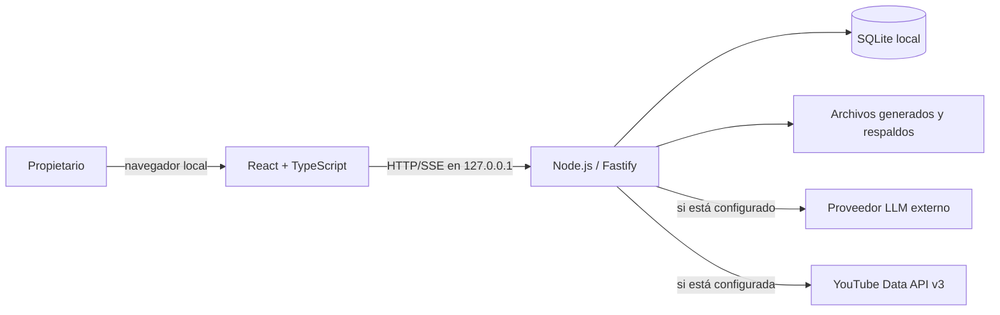
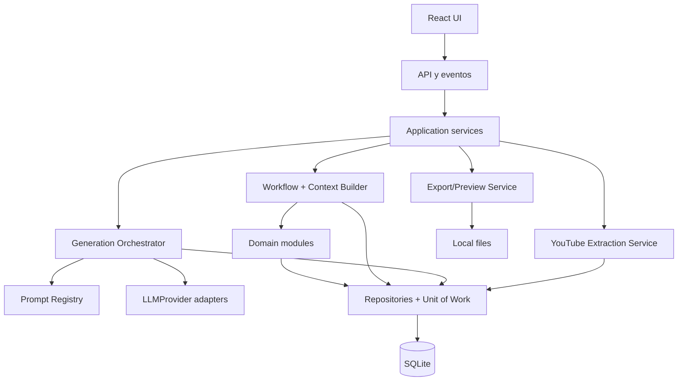
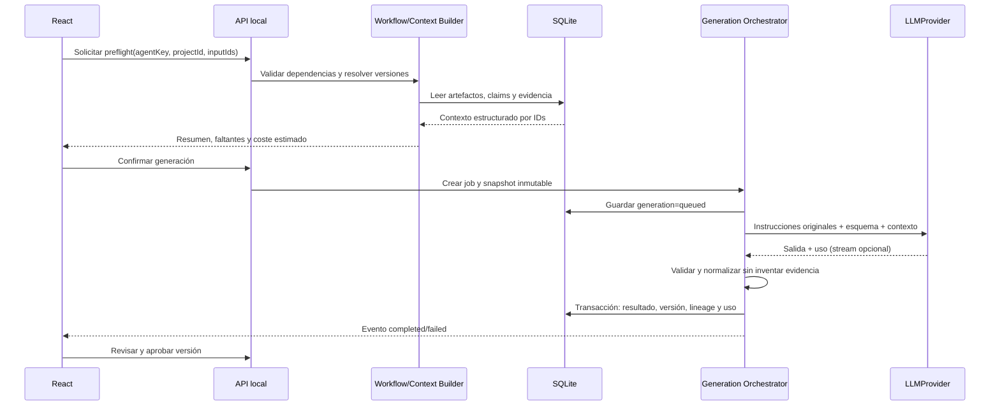

# Arquitectura técnica de la plataforma local

**Estado:** propuesta de diseño; sin implementación  
**Decisión principal:** React + TypeScript + Node.js + SQLite  
**Entorno verificado:** Windows, Node.js 24.15.0, npm 11.12.1 mediante `npm.cmd`, pnpm 11.16.0 y Git 2.55; Python y `sqlite3` CLI no instalados.

## 1. Decisión de arquitectura

Se recomienda la opción **B: React + backend Node.js + SQLite** como un monolito modular local.

La interfaz React se ejecutará en el navegador; una única aplicación Node.js servirá la API y, en distribución local, los archivos estáticos compilados. SQLite será accedida mediante una biblioteca embebida de Node, por lo que no hace falta instalar el ejecutable `sqlite3` ni operar un servidor de base de datos.

Esta decisión usa el runtime ya disponible, mantiene TypeScript de extremo a extremo y minimiza piezas operativas. El sistema no necesita Python para ninguno de sus requisitos actuales.

## 2. Comparación de opciones

| Criterio | A. React + FastAPI + SQLite | B. React + Node + SQLite | C. Todo Python + UI compatible |
|---|---|---|---|
| Runtimes actuales | Requiere instalar Python | Node ya disponible | Requiere instalar Python |
| Lenguaje compartido | TypeScript + Python | TypeScript completo | Python, con UI menos natural para este producto |
| UI compleja y previews | Muy buena | Muy buena | Posible, pero con más concesiones |
| Ecosistema APIs/LLM | Excelente | Excelente | Excelente |
| Mantenimiento local | Dos toolchains | Un toolchain | Un toolchain nuevo |
| Validación de contratos | Pydantic | JSON Schema + validación TS | Pydantic |
| Ajuste a Windows verificado | Medio | Alto | Bajo hoy |
| Recomendación | No elegida | **Elegida** | No elegida |

## 3. Stack propuesto

Las bibliotecas concretas se fijarán al iniciar la implementación y se bloquearán en el lockfile. La selección conceptual es:

| Capa | Elección | Motivo |
|---|---|---|
| Lenguaje | TypeScript estricto | Contratos compartidos y menos errores de integración |
| Frontend | React + Vite | UI modular, build local simple y preview rápida |
| Navegación | Router de cliente liviano | Módulos y proyectos con URLs locales navegables |
| Estado remoto | Cliente de consultas con caché | Invalidación y estados de carga coherentes |
| Formularios | Formularios tipados + validación por esquema | Edición segura de artefactos estructurados |
| Backend | Node.js LTS/compatible + Fastify | API local ligera, validación y plugins claros |
| Contratos | TypeBox o Zod, una sola opción para API y JSON Schema | Validación runtime y tipos derivados |
| Persistencia | SQLite embebida | Archivo local, transacciones, FKs y respaldo sencillo |
| Acceso a datos | Capa repositorio + migraciones SQL | Dominio independiente del driver |
| Trabajos | Cola persistente dentro del mismo proceso | Reanudar extracción/generación sin Redis |
| LLM | Adaptadores propios sobre SDKs oficiales | Evitar acoplamiento al proveedor |
| YouTube | REST/SDK oficial Data API v3 desde backend | Paginación y cuota legítimas |
| Logs | JSON local con redacción de secretos | Diagnóstico sin servicios externos |
| Pruebas | Unitarias, integración API/SQLite y E2E de navegador | Cobertura proporcional al riesgo |

No se adopta Electron al inicio: aumenta tamaño, actualizaciones y superficie de seguridad sin ser necesario. El servidor abre una URL local. Un shell de escritorio como Tauri podría evaluarse sólo después de estabilizar el producto.

## 4. Vista de contexto



Todo acceso a secretos, red externa, base de datos y sistema de archivos ocurre en el backend. El frontend nunca recibe claves de API.

## 5. Monolito modular

La aplicación se despliega como un solo proceso, pero el código se organiza por capacidades de dominio, no por una carpeta global de controladores.



### 5.1 Módulos de dominio

- `projects`: ciclo de vida y configuración del proyecto;
- `research`: fuentes, consultas, hallazgos y evidencia;
- `youtube`: videos, hilos, comentarios, cursores y cuota;
- `problems`: clusters, citas y métricas;
- `opportunities`: scoring, pesos, selección y confianza;
- `products`: concepto, estructura, módulos y recursos;
- `avatars`: atributos y evidencia;
- `mechanisms`: hipótesis causal y diferenciación;
- `beliefs`: creencias, objeciones y tesis central;
- `offers`: precios, entregables y ofertas derivadas;
- `landings`: copy, secciones, assertions y preview;
- `funnels`: nodos, transiciones y condiciones;
- `emails`: secuencias y mensajes;
- `content`: piezas y calendario;
- `generated-files`: exportadores y metadatos;
- `generations`: prompts, modelos, uso, coste y versiones;
- `workflow`: dependencias, aprobaciones, lineage y staleness.

## 6. Capas y responsabilidades

### 6.1 Presentación

React muestra proyectos, editores, evidencia, estados y previews. Puede formatear datos, pero no calcula scoring autoritativo, no ensambla prompts y no decide qué versiones alimentar a un agente.

### 6.2 API local

La API valida solicitudes, resuelve el proyecto y llama servicios de aplicación. Los endpoints se agrupan por dominio. No se crea un endpoint diferente por cada prompt; se usa un comando de generación tipado con `agentKey`, IDs de entrada y opciones permitidas.

Familias previstas:

| Familia | Finalidad |
|---|---|
| `/api/projects` | Proyecto, configuración, respaldo y progreso |
| `/api/sources` | Fuentes y evidencia importada |
| `/api/youtube` | Videos, extracción, paginación y cuota |
| `/api/problems` | Análisis, revisión y evidencia |
| `/api/opportunities` | Componentes, fórmulas y selección |
| `/api/artifacts` | Versiones, aprobación y lineage |
| `/api/generations` | Preflight, ejecución, streaming, cancelación e historial |
| `/api/workflow` | Estado, dependencias y staleness |
| `/api/files` | Previews, exportación y descargas locales |
| `/api/settings` | Proveedores, perfiles, precios y claves enmascaradas |

La forma final REST o RPC tipado se decide en la fase de esqueleto. La arquitectura exige contratos de esquema compartidos y no depende del estilo de transporte.

### 6.3 Servicios de aplicación

Orquestan casos de uso y transacciones: aprobar oportunidad, generar avatar, reanudar extracción o crear respaldo. No contienen detalles de UI ni SDKs externos.

### 6.4 Dominio

Contiene invariantes puras:

- pesos de scoring suman 100%;
- un total sólo usa componentes válidos;
- una versión aprobada pertenece al mismo proyecto;
- una cita conserva su texto original;
- una prueba social exige evidencia;
- una relación de lineage no puede cruzar proyectos;
- una oferta seleccionada debe referir a un producto aprobado.

### 6.5 Infraestructura

Implementa repositorios SQLite, migraciones, adaptadores LLM, YouTube, sistema de archivos, reloj y cálculo de tokens/costes.

## 7. Flujo de una generación



El snapshot de entrada hace reproducible qué vio el agente aunque las entidades cambien después.

## 8. Abstracción LLM

### 8.1 Contrato conceptual

`LLMProvider` recibe una solicitud normalizada y devuelve resultado, uso y metadata no sensible. El dominio no conoce nombres de SDK ni endpoints del proveedor.

La solicitud contiene:

- provider profile y model profile;
- mensajes/instrucciones construidos en backend;
- esquema de salida;
- opciones soportadas (límite, creatividad, streaming);
- identificador idempotente de generación;
- política de timeout/cancelación.

La respuesta contiene:

- texto o datos estructurados;
- estado de terminación;
- tokens de entrada/salida/cache cuando estén disponibles;
- modelo realmente reportado;
- identificador remoto redactable;
- advertencias del proveedor.

### 8.2 Perfiles y routing

- `economy`: limpieza, clasificación simple y variaciones;
- `balanced`: análisis y redacción general;
- `powerful`: síntesis compleja, mecanismo u oferta cuando el usuario lo decida.

Los perfiles son configurables. El router nunca deduce que un modelo de marca concreta es obligatorio. El usuario puede asignar proveedor/modelo y establecer fallback; todo cambio queda fechado.

### 8.3 Prompts

Estructura prevista:

- `prompts/<agent-key>/system.md`;
- `prompts/<agent-key>/task.md`;
- `prompts/<agent-key>/schema.json`;
- manifiesto con versión, variables y changelog.

Los prompts son originales, revisables y fuera del bundle frontend. Una generación conserva `prompt_version` y hashes de los archivos efectivos.

### 8.4 Validación y reparaciones

1. Validar JSON/estructura.
2. Validar IDs y que pertenezcan al proyecto.
3. Rechazar referencias a evidencia inexistente.
4. Aplicar reglas del dominio.
5. Si sólo falla la forma, hacer como máximo un intento de reparación explícito y contabilizado.
6. Si falla semánticamente, guardar error y solicitar revisión; no rellenar silenciosamente.

## 9. Uso, tokens y costes

Antes de generar, un estimador local calcula tokens aproximados y usa una tabla de precios configurable y fechada. Después, se guarda el uso reportado por el proveedor; si no existe, queda `estimated`.

Se muestran:

- proveedor y modelo;
- input/output/cache tokens;
- coste estimado previo;
- coste final estimado o calculado;
- moneda y versión de tarifa;
- latencia, reintentos y estado;
- totales por generación, agente, módulo y proyecto.

No se hardcodean precios como verdades permanentes. Las tarifas pueden actualizarse sin migrar generaciones históricas.

## 10. Persistencia SQLite

- Un archivo principal por instalación, no uno por proyecto; facilita consultas, migraciones y configuración.
- `PRAGMA foreign_keys=ON` en todas las conexiones.
- Modo WAL cuando sea compatible con la ubicación local.
- Transacciones para generación + artefacto + lineage + uso.
- Migraciones numeradas, forward-only durante desarrollo y respaldo automático antes de migrar.
- Timestamps UTC ISO-8601; UI los muestra en zona local.
- JSON sólo para snapshots o extensiones variables; las relaciones consultables se normalizan.
- Búsqueda de texto mediante FTS5 si el driver la incluye; fallback a búsqueda normal.

El CLI `sqlite3` no es requisito: el driver abre y migra la base embebida.

## 11. Trabajos largos y streaming

La extracción, análisis por lotes y generación de archivos se representan como `jobs` persistentes. Una cola en proceso ejecuta uno o pocos trabajos para evitar sobreconsumo.

Estados: `queued`, `running`, `waiting_rate_limit`, `completed`, `failed`, `cancelled`.

- YouTube guarda cursor y estadísticas por página.
- Un job interrumpido puede reanudarse desde el último checkpoint seguro.
- Generaciones LLM no se reenvían automáticamente si el estado remoto es ambiguo.
- SSE comunica progreso y chunks; polling queda como fallback.
- Cancelar detiene trabajo futuro, pero conserva auditoría y resultados ya confirmados.

## 12. Extractor de YouTube

```mermaid
flowchart LR
    URL["URL/ID de video"] --> VAL["Validación"]
    VAL --> META["videos.list"]
    META --> THREADS["commentThreads.list paginado"]
    THREADS --> REPLIES["comments.list si faltan replies"]
    REPLIES --> NORM["Normalizar sin perder original"]
    NORM --> DEDUPE["Dedupe por platform ID/hash"]
    DEDUPE --> TX["Transacción SQLite"]
    TX --> CK["Cursor, cuota y resumen"]
```



El orden, límite y replies son opciones explícitas. Se conserva una huella del request no secreta y el ETag si resulta útil. La clave queda en backend. No se analiza con IA hasta que el usuario invoque el Analizador de problemas.

## 13. Context Builder y lineage

Cada agente declara un `Context Contract`: tipos de entrada, campos necesarios, máximos y estrategia de selección. El Context Builder:

1. recibe IDs elegidos o resuelve versiones aprobadas;
2. verifica proyecto y estado;
3. recupera sólo campos permitidos;
4. selecciona evidencia con estrategia registrada;
5. calcula presupuesto de contexto;
6. crea un snapshot inmutable;
7. registra lineage desde entradas a salida.

No concatena todo el proyecto ni historial de chat indiscriminadamente. Cuando el corpus es grande, usa estadísticas deterministas, clusters y muestras de evidencia, registrando exactamente cuáles.

## 14. Archivos y previews

Los archivos viven bajo un directorio de datos configurable, fuera del código fuente:

- `data/database/` para SQLite y backups;
- `data/projects/<project-id>/imports/` para originales importados;
- `data/projects/<project-id>/generated/` para exportaciones;
- `data/previews/` para artefactos temporales regenerables;
- `data/logs/` para logs redactados.

En implementación se validará con resolución canónica que ningún nombre o ruta salga del directorio permitido. La preview HTML se sirve en un origen/ruta aislada con CSP restrictiva y sandbox; no ejecuta scripts generados por el LLM en el MVP.

## 15. Seguridad local

Aunque no hay login, “local” no significa “sin controles”:

- escuchar sólo `127.0.0.1`, nunca `0.0.0.0` por defecto;
- aceptar sólo orígenes locales conocidos;
- generar un secreto efímero de sesión local para reducir peticiones cross-site;
- API keys en `.env` o almacén del sistema en una fase posterior;
- `.env`, datos, backups y logs en `.gitignore`;
- `.env.example` sólo con nombres y explicaciones;
- redacción de headers, claves y cuerpos sensibles en logs;
- allowlist de hosts de salida del módulo YouTube/LLM;
- límites de tamaño, timeout y tipos MIME;
- consultas parametrizadas y nada de SQL generado por LLM;
- escape de texto y sanitización de HTML;
- sin telemetría externa por defecto.

## 16. Respaldo, restauración y portabilidad

Un respaldo incluye base consistente, manifiesto de versión, archivos importados/generados y checksums; excluye secretos por defecto. La restauración ocurre en una ubicación nueva, valida hashes y versión, y sólo sustituye datos activos tras superar verificaciones.

Debe existir una exportación legible de proyecto en JSON además del backup operativo. Esto permite conservar resultados aunque cambie la aplicación.

## 17. Estructura prevista del repositorio

La estructura es una decisión de diseño, no directorios implementados todavía:

```text
apps/
  web/                 React UI
  server/              Fastify y composición
packages/
  contracts/           esquemas y tipos compartidos
  domain/              reglas puras
  database/            migraciones y repositorios
  llm/                 contrato y adaptadores
  prompts/             prompts originales versionados
  youtube/             cliente, paginación y normalización
  exporters/           HTML/PDF/etc. por adaptadores
tests/
data/                  ignorado por Git
docs/                  especificaciones
```

Podrá gestionarse como workspace de npm/pnpm. En esta máquina, los comandos documentados deben usar `npm.cmd` o `pnpm.cmd` cuando PowerShell bloquee wrappers `.ps1`.

## 18. Estrategia de pruebas

- **Dominio:** scoring, pesos, estados, staleness, lineage e invariantes.
- **Persistencia:** migraciones, FKs, transacciones, backup/restore y concurrencia WAL.
- **YouTube:** paginación, replies, dedupe, reanudación, cuota y fixtures sin red.
- **LLM:** adaptador falso determinista, schemas inválidos, timeout, coste y redacción.
- **API:** proyecto equivocado, IDs inexistentes, idempotencia y cancelación.
- **UI:** flujo feliz, faltantes, aprobación, versión obsoleta y navegación de evidencia.
- **E2E:** un proyecto sintético desde importación hasta landing, sin llamar APIs pagadas.

## 19. Decisiones diferidas

- Driver SQLite exacto y ORM/query builder, mediante spike corto.
- REST frente a RPC tipado, manteniendo los mismos contratos.
- Proveedor LLM inicial; la arquitectura no presupone uno.
- Empaquetado con instalador o script local después del MVP.
- PDF y formatos avanzados después de validar HTML/Markdown.
- RAG/vector store sólo si pruebas con corpus reales demuestran necesidad; SQLite FTS y selección estructurada son el punto de partida.

## 20. Límites arquitectónicos

No se añadirán microservicios, Redis, broker, base vectorial, autenticación, nube o framework de agentes autónomos sin un problema medido que los justifique. Los “agentes” son capacidades deterministas y/o LLM coordinadas por servicios explícitos, no procesos autónomos con permisos abiertos.
