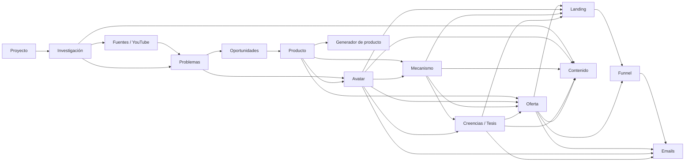
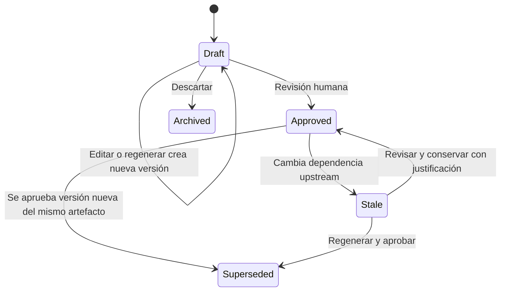

# Workflow de proyecto y transferencia automática de contexto

**Estado:** especificación operativa; sin implementación  
**Objetivo:** definir exactamente cómo pasan datos por IDs, versiones y evidencia, sin copiar/pegar.

## 1. Regla central

Cada módulo publica uno o más artefactos versionados. El siguiente módulo consume las **versiones aprobadas exactas**, no el texto visible de la pantalla ni el “último chat”.

Una solicitud de agente contiene:

- `projectId`;
- `agentKey`;
- IDs de entidades/artefactos elegidos cuando existe una selección explícita;
- IDs de versiones aprobadas resueltas por backend;
- parámetros de la ejecución;
- nunca secretos, cookies ni texto copiado manualmente como sustituto de datos existentes.

El Context Builder resuelve esos IDs a un snapshot estructurado y registra `generation_inputs` y `lineage_edges`.

## 2. Estados del workflow

| Estado | Significado |
|---|---|
| `not_started` | No existe actividad |
| `ready` | Dependencias mínimas disponibles |
| `in_progress` | Trabajo manual/job en curso |
| `needs_review` | Hay draft válido pendiente de decisión |
| `approved` | Existe una versión aprobada y fresca |
| `stale` | Existe resultado, pero cambió una entrada relevante |
| `blocked` | Falta una dependencia obligatoria o configuración externa |
| `failed` | Último job falló; resultados previos no se pierden |

Un módulo puede estar `ready` aunque upstream tenga datos parciales si su contrato lo admite. La UI muestra qué falta y el impacto.

## 3. Grafo principal

No es una línea rígida: Avatar puede comenzar desde problemas antes de fijar el producto, pero su versión final queda obsoleta si cambia la oportunidad/producto que la contextualiza.

## 4. Contratos de contexto

Cada agente declara:

- **required inputs:** sin ellos no ejecuta;
- **optional inputs:** enriquecen sin bloquear;
- **selection rule:** qué versión/entidad se usa;
- **evidence strategy:** universo, filtros y muestra;
- **size limits:** presupuesto aproximado de tokens/elementos;
- **staleness policy:** qué cambio invalida su resultado;
- **output artifact type:** resultado versionado.

El backend no acepta un `artifactVersionId` de otro proyecto ni una versión draft como entrada obligatoria salvo modo de exploración explícito.

## 5. Flujo exacto de extremo a extremo

### Paso 0 — Crear proyecto

**Acción:** el usuario crea proyecto con nombre, nicho, idioma, región y moneda.

**IDs creados:**

- `projectId`;
- filas `workflow_steps`;
- `projectSettingsId`;
- `scoreFormulaId` apuntando a la fórmula inicial versionada.

**Salida:** Research queda `ready`; módulos dependientes quedan `blocked/not_started` con razones visibles.

### Paso 1 — Investigación

**Request lógico:**

`projectId + researchQuestionIds opcionales + sourceIds verificados + parámetros`

**Resolución:** Context Builder lee proyecto, configuración, fuentes verificadas y hallazgos anteriores aprobados.

**Creación:**

- `generationId` si se usa IA;
- `researchArtifactId` y `researchArtifactVersionId`;
- `researchQuestionIds`, `searchQueryIds`, `findingIds`, `claimIds`;
- `claimEvidence` sólo para evidence IDs existentes.

**Aprobación:** el usuario corrige/valida. Las búsquedas sugeridas siguen marcadas como sugerencias hasta ejecutarse o documentarse.

**Pasa downstream:** `researchArtifactVersionId`, fuentes verificadas y preguntas abiertas; nunca una lista de URLs ficticiamente “consultadas”.

### Paso 2 — Importar fuentes y comentarios

**YouTube request lógico:**

`projectId + videoUrlOrId + order + includeReplies + userLimitPolicy`

**Creación inmediata:** `jobId`, `importRunId`, `sourceId`, `videoId`.

**Por página:**

1. recuperar página oficial;
2. guardar `importPageId` y checkpoint;
3. upsert de `threadIds` y `commentIds` por platform ID;
4. conservar `parentCommentId`;
5. crear/actualizar summary del run.

**Final:** el run devuelve IDs y conteos. No envía comentarios a un LLM.

**Pasa downstream:** una selección guardada `analysisSetId` formada por `commentIds` y/o `sourceIds`.

### Paso 3 — Definir universo de análisis

El usuario filtra por videos, fechas, top-level/replies y otros criterios. El backend materializa:

- `analysisSetId`;
- `analysisSetItemIds`;
- denominador deduplicado;
- hash del conjunto.

Esto evita que un análisis futuro cambie silenciosamente si se sincronizan nuevos comentarios. Para incluirlos se crea una nueva versión del analysis set.

### Paso 4 — Analizar problemas

**Request lógico:**

`projectId + analysisSetId + problemAnalysisOptions`

**Context:** IDs de evidencia derivados del conjunto, texto original, metadata permitida y agregados deterministas.

**Ejecución:**

1. normalización y estadísticas sin LLM;
2. lotes de clasificación/clustering;
3. síntesis de clusters;
4. validación de todos los evidence IDs;
5. cálculo determinista de frecuencia sobre el analysis set.

**Creación:** `problemSetArtifactVersionId`, `problemIds`, `claimIds`, `evidenceSnippetIds`, `problemEvidence`.

**Revisión:** usuario fusiona, divide, renombra o descarta problemas; cada cambio genera versión. Las citas siempre abren el comentario/fuente.

**Pasa downstream:** versión aprobada del problem set, problem IDs aprobados y analysis set ID.

### Paso 5 — Puntuar oportunidades

**Request lógico:**

`projectId + problemSetArtifactVersionId + problemIds + scoreFormulaId + marketFindingIds opcionales`

**Cálculo:**

- frecuencia se deriva de `problem_evidence` y denominador;
- urgencia/intensidad/disposición/facilidad/competencia/diferenciación reciben valores, procedencia, confianza y evidencia;
- total = suma determinista de contribuciones según fórmula;
- unknown sigue la política versionada de la fórmula.

**Creación:** `evaluationRunId`, `opportunitySetArtifactVersionId`, `opportunityIds`, `opportunityComponentIds`.

**Decisión humana:** el usuario establece `primary_opportunity` apuntando a `opportunityId` y su versión aprobada. El ranking no elige automáticamente el negocio.

**Pasa downstream:** `opportunityId`, versión, problem ID origen, score components y evidence graph.

### Paso 6 — Construir producto

**Request lógico:**

`projectId + opportunityId + opportunityArtifactVersionId + constraints`

**Context:** oportunidad, problema, componentes, evidence summaries/citas seleccionadas, decisiones de formato y recursos del usuario.

**Creación:** `productId`, `productArtifactVersionId`, módulos, outcomes, resources, assumptions, risks y lineage.

**Aprobación:** establece `primary_product`.

**Pasa downstream:** producto aprobado y las IDs upstream que lo justifican.

### Paso 7 — Construir avatar

**Request lógico:**

`projectId + problemSetVersionId + selectedProblemIds + productId opcional + segmentCriteria`

**Context:** atributos derivados de evidencia, lenguaje, objeciones, deseos y producto seleccionado. No se incluye demografía inferida sin señales.

**Creación:** `avatarId`, `avatarArtifactVersionId`, `avatarAttributeIds`, claims/evidence.

**Aprobación:** establece `primary_avatar`.

**Pasa downstream:** atributos con provenance y evidence IDs, no un párrafo sin estructura.

### Paso 8 — Construir mecanismo

**Request lógico:**

`projectId + productArtifactVersionId + avatarArtifactVersionId + problemIds + alternativeFindingIds`

**Context:** producto, problemas, intentos previos, objeciones, evidencia a favor/en contra.

**Creación:** `mechanismId`, `mechanismArtifactVersionId`, claim IDs, assumption IDs y evidence links.

**Aprobación:** establece `primary_mechanism`.

**Pasa downstream:** causa propuesta con etiqueta de inferencia, mecanismo de solución, diferenciadores y límites.

### Paso 9 — Creencias y tesis central

**Request lógico:**

`projectId + avatarVersionId + mechanismVersionId + productVersionId`

**Creación:** `beliefSetId`, `beliefSetArtifactVersionId`, `beliefIds`, `beliefTransitionIds`, central thesis claim ID.

**Aprobación:** establece `primary_belief_set`.

**Pasa downstream:** creencias/objeciones y tesis con referencias exactas.

### Paso 10 — Construir oferta

**Request lógico:**

`projectId + productVersionId + avatarVersionId + mechanismVersionId + beliefSetVersionId + commercialDecisions`

El preflight separa datos derivados de decisiones del usuario: moneda, precio, garantía y restricciones. El agente puede proponer, pero la versión no se aprueba sin confirmación.

**Creación:** `offerId`, `offerArtifactVersionId`, deliverables/benefits/bonuses y ofertas hijas (`orderBumpOfferId`, `upsellOfferId`, `downsellOfferId`).

**Aprobación:** establece `primary_offer`.

**Pasa downstream:** estructura de oferta y claims autorizados.

### Paso 11 — Construir landing

**Request lógico:**

`projectId + offerVersionId + productVersionId + avatarVersionId + mechanismVersionId + beliefSetVersionId + styleOptions`

**Creación:** `landingId`, `landingArtifactVersionId`, `landingSectionIds`, `landingAssertionIds`.

**Validación de prueba:** cada assertion de métrica/testimonio/autoridad debe enlazar `claimId/evidenceId`. Sin ellos, se bloquea o se convierte en placeholder claramente marcado.

**Render:** el servicio programático recibe `landingArtifactVersionId` y crea `generatedFileId` para preview sanitizada. No usa el HTML del LLM como fuente de verdad.

**Pasa downstream:** landing aprobada, offer ID y preview file ID.

### Paso 12 — Construir funnel

**Request lógico:**

`projectId + landingVersionId + offerVersionId + childOfferIds + flowOptions`

**Creación:** `funnelId`, `funnelArtifactVersionId`, `funnelNodeIds`, `funnelEdgeIds`.

**Validación:** conectividad, entry único, transiciones accept/decline y checkout simulado. El grafo guarda IDs de landing/ofertas; no duplica su copy.

### Paso 13 — Emails

**Request lógico:**

`projectId + sequenceType + offerVersionId + avatarVersionId + beliefSetVersionId + mechanismVersionId + funnelVersionId opcional + quantity/tone`

**Creación:** `emailSequenceId`, `emailSequenceArtifactVersionId`, `emailIds` y claim links. Las secuencias leen contexto automáticamente de esas versiones.

### Paso 14 — Contenido

**Request lógico:**

`projectId + channel + dateRange + contentTypes + avatarVersionId + mechanismVersionId + beliefSetVersionId + offerVersionId + researchVersionId opcional`

**Creación:** `contentBatchArtifactVersionId`, `contentCalendarId`, `contentItemIds` y claim/evidence links.

No publica. Una exportación posterior trabaja con los IDs aprobados.

### Paso 15 — Generar archivos de producto

**Request lógico:**

`projectId + productVersionId + productContentVersionIds + format + themeId + exportLocationAlias`

**Creación:** `jobId`, `generatedFileIds`, checksums y `fileLineage`. Las rutas se resuelven en backend dentro del directorio permitido.

## 6. Preflight de una generación

Antes de gastar tokens, la API devuelve:

- agente y prompt version;
- IDs/versiones de entrada resueltos;
- dependencias faltantes o stale;
- conteo de evidencia y estrategia de selección;
- tokens aproximados de input/output;
- proveedor/modelo lógico y real configurado;
- coste aproximado/unknown;
- advertencias de privacidad o falta de confianza;
- hash preliminar del input.

El usuario confirma o cambia selección/perfil. La confirmación crea un `generationId` con snapshot inmutable.

## 7. Selección de evidencia para contextos grandes

El sistema aplica una estrategia declarada y registrada:

1. métricas del universo completo calculadas localmente;
2. evidencia representativa por cluster y por polaridad;
3. citas de alta relevancia y contraejemplos;
4. límite por fuente/video para evitar dominancia;
5. selección estable con seed/version cuando haya muestreo;
6. lista completa de IDs seleccionados en `generation_inputs`.

Si hay demasiada evidencia, se hace análisis jerárquico por lotes. Los resúmenes intermedios también son artefactos/versiones; no sustituyen evidencia original.

## 8. Aprobación y edición

- Regenerar nunca modifica la versión previa.
- Editar manualmente registra `createdBy=user` y un resumen de cambios.
- Aprobar una nueva versión convierte la anterior en `superseded`, pero conserva lineage.
- Conservar una versión stale exige una nota; crea un evento de resolución, no falsifica sus entradas originales.

## 9. Propagación de staleness

### 9.1 Política

Cuando cambia una selección o se aprueba una versión upstream:

1. buscar lineage/dependencias directas;
2. crear `staleness_event` para downstream afectado;
3. marcar freshness `stale` sin borrar status/editorial;
4. propagar transitivamente según `workflow_dependencies`;
5. mostrar la causa concreta y diferencia de versión;
6. permitir regenerar desde el primer punto afectado.

### 9.2 Matriz inicial

| Cambio | Se marca stale |
|---|---|
| Analysis set/comentarios incluidos | Problemas y todo descendiente que use esa versión |
| Problem set | Oportunidades, avatar y descendientes |
| Oportunidad seleccionada | Producto y todo descendiente del producto |
| Producto | Mecanismo, oferta, landing, funnel, emails, contenido y archivos |
| Avatar | Mecanismo, beliefs, oferta, landing, emails y contenido |
| Mecanismo | Beliefs, oferta, landing, emails y contenido |
| Belief set/tesis | Oferta, landing, emails y contenido |
| Oferta | Landing, funnel, emails y contenido comercial |
| Landing | Funnel y previews |
| Fórmula/pesos | Opportunity evaluation; producto no se invalida automáticamente si la oportunidad seleccionada no cambia, pero recibe warning de revisión |

No todo cambio obliga a regenerar. Una corrección ortográfica puede marcar `review_required` en vez de stale semántico si el diff se clasifica manualmente; el MVP puede usar política conservadora.

## 10. Errores, reintentos y reanudación

### 10.1 LLM

- Error antes de respuesta: generación `failed`; retry manual crea nuevo ID enlazado.
- Estructura inválida: un intento de reparación opcional, contabilizado.
- Timeout ambiguo: no reenviar automáticamente.
- Cancelación: conservar uso/chunks reportados, no crear artefacto aprobable incompleto salvo acción de recuperación.

### 10.2 YouTube

- Cada página confirmada queda guardada.
- Rate limit/cuota: job `waiting_rate_limit` o `failed` con cursor.
- Reanudar usa el import run y cursor; upserts hacen la operación idempotente.
- Comentarios eliminados se marcan después de una sincronización comparativa; no se borran si ya sustentan evidencia.

### 10.3 Archivos

- Render a archivo temporal dentro de data.
- Validar formato/checksum.
- Mover de forma atómica a nombre versionado.
- Nunca sobrescribir un archivo aprobado sin nueva versión.

## 11. Historial y reproducibilidad

Para una salida seleccionada, la UI debe responder:

- ¿qué generación la creó? (`generationId`);
- ¿qué prompt? (`promptVersionId`);
- ¿qué modelo? (`provider/model reported`);
- ¿qué datos exactos? (`generationInputs`, snapshot hash);
- ¿qué evidencia? (`evidenceSnippetIds`);
- ¿qué cambió después? (`stalenessEvents`);
- ¿cuánto costó? (`llmUsageId`);
- ¿qué archivos produjo? (`generatedFileIds`).

“Reproducir” no promete el mismo texto en un LLM no determinista. Significa reconstruir las mismas entradas, instrucciones, opciones y modelo cuando siga disponible.

## 12. Experiencia de navegación

En la barra lateral, cada módulo muestra estado y conteo. En el área principal:

- **Inputs:** versiones resueltas y posibilidad de elegir otra aprobada.
- **Evidence:** fuente/cita y procedencia.
- **Result:** editor del esquema, no sólo chat.
- **Versions:** diff, autor, generación y aprobación.
- **Usage:** tokens, coste y latencia.
- **Downstream:** artefactos que consumen esta versión y su freshness.

Un breadcrumb de trazabilidad permite desde una frase de landing llegar a `landingAssertionId → claimId → problemId/opportunityId → evidenceSnippetId → commentId/sourceId`.

## 13. Escenario de aceptación completo

1. Crear proyecto `Organización de fotografías`.
2. Importar dos videos; guardar 1 200 comentarios con replies y sin duplicados.
3. Crear un analysis set fijo de 1 150 comentarios elegibles.
4. Obtener problemas con citas navegables y frecuencia reproducible.
5. Puntuar oportunidades; cambiar pesos y observar recálculo determinista.
6. Seleccionar una oportunidad y aprobar producto/avatar/mecanismo/tesis/oferta.
7. Generar landing; verificar que claims muestran lineage y que no hay testimonios falsos.
8. Crear funnel, emails y contenido sin copiar texto manualmente.
9. Cambiar el producto aprobado; observar downstream stale con la causa.
10. Restaurar un backup y comprobar mismos IDs, versiones, lineage y archivos.

Este escenario será la prueba E2E principal del MVP con proveedores simulados para no gastar dinero.
