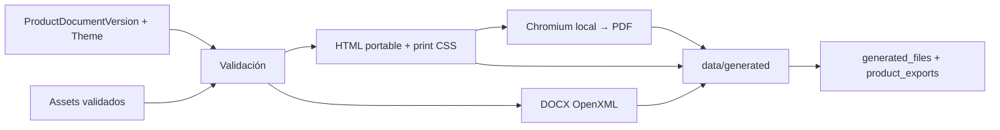

# Arquitectura de exportación de productos

`ProductDocumentVersion` es la fuente canónica. HTML, DOCX y PDF son derivados físicos e inmutables de una versión concreta.

- Assets viven en `data/assets/<projectId>/`; exports en `data/generated/<projectId>/product-studio/`.
- Cada archivo registra formato, `documentVersionId`, ruta relativa, bytes, SHA-256 y fecha. El nombre incluye versión, timestamp y sufijo único; nunca se sobrescribe silenciosamente.
- HTML incorpora imágenes/SVG como data URLs, escapa texto y no contiene JavaScript.
- DOCX soporta portada, headings, párrafos, listas, tablas, imágenes/diagramas, page breaks, header y footer.
- PDF se imprime localmente desde el mismo HTML mediante Edge/Chromium headless.
- Rutas, MIME, extensión, bytes, dimensiones y SVG se validan. Los joins y triggers impiden cruces entre proyectos.
- Backup/restore incluye sidecars para `generated`, `assets` y `knowledge`, con comprobación de checksum.
